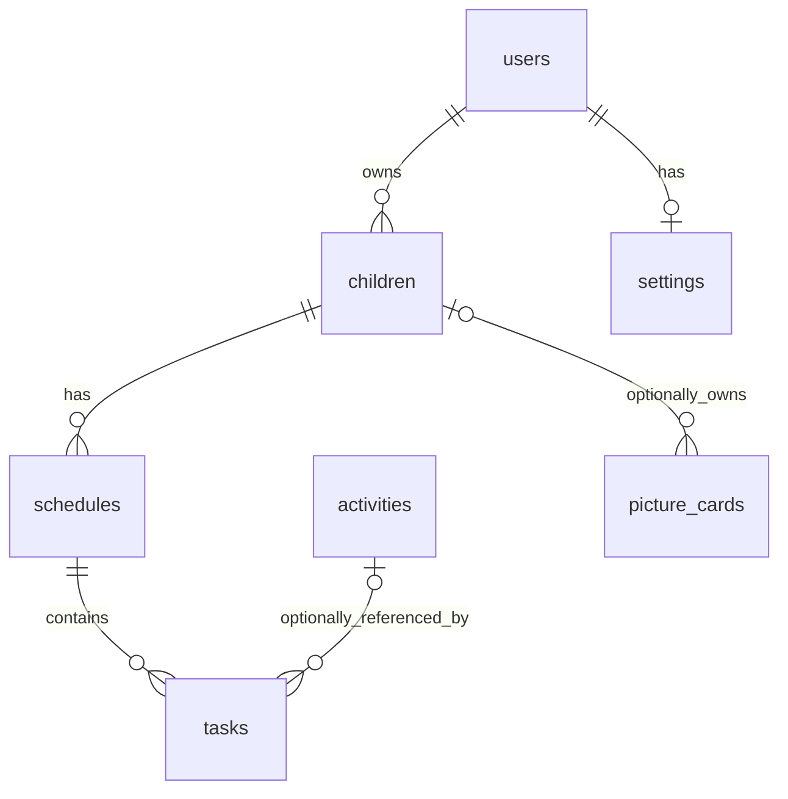
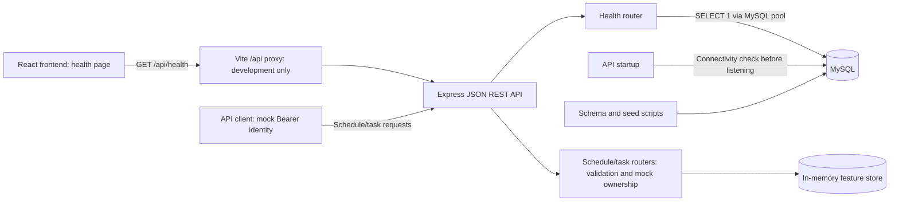

# Development Team Handoff Document

**Project:** Web-Based Visual Schedule, Task Management and Communication System for Children with Developmental Delays 
**Reviewed:** November 15, 2026 
**Audience:** Development, SRS and Research teams

This is a source-verified implementation snapshot, not a requirements specification or research report. **The repository has an application foundation and mock-backed schedule/task APIs; it does not yet demonstrate a completed CRUD backend or an end-to-end product.** Existing documentation agrees with these limits.

## 1. Project overview

The intended system helps caregivers, occupational therapists (OTs) and SPED teachers organize children's daily routines. Children are intended to follow visual schedules, complete tasks and communicate through picture cards. These purposes come from the [SRS](SRS.md); the Staff and Child interfaces and communication features are still pending.

The implemented stack is TypeScript, React 19 with Vite 7, Node.js (required version >=22.12.0), Express 5, MySQL via `mysql2/promise`, and shared Zod validation. npm workspaces organize the project; Vitest and Supertest test API behavior. Setup, environment variables and commands are in the [README](../README.md#run-locally).

## 2. System structure

| Location | Responsibility and important components |
| --- | --- |
| `apps/web/src/` | React frontend. `App.tsx` displays API health; `lib/api.ts` only fetches health. No product screens exist. |
| `apps/web/vite.config.ts` | Development server on port 5173; proxies `/api` to the backend, normally port 3001. |
| `apps/api/src/app.ts`, `server.ts` | Express middleware/router setup; environment loading, database startup check, listener and shutdown. |
| `apps/api/src/routes/` | Only health, schedules and tasks routers; two schedule/task test files. |
| `apps/api/src/mocks/` | Fixed Bearer identities and process-local child/activity/schedule/task data used by feature routes. |
| `apps/api/src/db/`, `lib/` | MySQL pool/connectivity helpers; centralized JSON errors and validation helpers. |
| `apps/api/schema.sql`, `scripts/` | Seven-table SQL definition, schema application and transactional demo seeding. |
| `packages/shared/src/` | Zod enums and schedule/task input schemas; health response type. Schedule/task resource interfaces remain in the mock data module. |
| `docs/`, root `scripts/` | Existing technical/requirements documentation; optional commit-message hook installer. |

See [Architecture](ARCHITECTURE.md#workspace-layout) for the full layout and build details. There is no separate service/repository data layer for persistent feature CRUD yet.

## 3. Current functionality

### Users and access

The SQL/shared role values are `caregiver`, `ot` and `sped_teacher`. Current middleware accepts only `Bearer 1` (Alice, caregiver; owns Mia and Leo) and `Bearer 2` (Bob, OT; owns Ava). These are fixed IDs with no password verification, signature or expiry. There are no role-specific permissions, child login or implemented Child view. Schedule/task handlers check ownership against the selected mock identity and return 404 for another identity's resources. **Callers can select either identity by changing the token, so these checks do not establish real authenticated data isolation.**

### Available operations and workflow

Using an API client with a mock identity, a developer can:

1. Create a schedule for an owned fixture child and date, or copy that child's schedule from another date. Duplicate child/date combinations return 409. Copies preserve task content, order and timing but reset completion.
2. Add a library activity or custom task (name plus an allowed emoji). Set/clear start time and duration, reorder tasks, or remove tasks; positions remain consecutive and start at 1.
3. Read the schedule with ordered tasks; mark a task done or undo it. Completion records an ISO UTC timestamp; repeated completion preserves it, and undo clears it.
4. Change the schedule date or delete the schedule and its tasks.

Schedules support create/read/update/delete. Tasks support create, read through schedules, limited update, delete and completion/undo. Task updates cannot change name, icon or activity reference. Child profiles, accounts, cards and settings have **no CRUD routes**; activities have no listing endpoint. All schedule/task changes disappear on API restart or watcher reload.

The browser currently only displays the result of `GET /api/health`. It cannot perform the workflow above. Source: [schedule routes](../apps/api/src/routes/schedules.ts), [task routes](../apps/api/src/routes/tasks.ts), [mock store](../apps/api/src/mocks/data.ts) and [frontend](../apps/web/src/App.tsx).

## 4. Database design

The following describes the actual definitions in [schema.sql](../apps/api/schema.sql), **not verified tables in a running database**. IDs are unsigned auto-increment `BIGINT` primary keys except `settings.user_id`, which is both primary and foreign key. All tables use InnoDB and `utf8mb4`.

| Table | Fields and important constraints |
| --- | --- |
| `users` | `id`, `name`, unique `email`, nullable `password_hash`, `role` (`caregiver/ot/sped_teacher`), `created_at`. |
| `children` | `id`, required `user_id` owner FK, `name`, unsigned tiny-integer `age`, `delay_domain` (`speech/motor/cognitive/social/general`), nullable `notes`, `avatar`, `created_at`. |
| `activities` | `id`, unique `name`, `icon`, `category` (`hygiene/food/school/play/other`); shared library without an owner. |
| `schedules` | `id`, required `child_id` FK, `schedule_date` (`DATE`), `created_at`; unique `(child_id, schedule_date)`. |
| `tasks` | `id`, required `schedule_id` FK, nullable `activity_id` FK, snapshot `name`/`icon`, nullable `start_time` (`TIME`), nullable `duration_min`, `position`, `status` (`pending/done`, default pending), nullable `completed_at` (`DATETIME`); unique `(schedule_id, position)`. |
| `picture_cards` | `id`, nullable `child_id` FK, `category` (`Food/Emotions/Activities/Needs`), `label`, `icon`, `created_at`. Null child means shared default; otherwise child-specific. No visibility/hide field. |
| `settings` | `user_id` PK/FK, `font_size` (`small/medium/large`, default medium), `contrast` (`normal/high`, default normal), `sound_on` (boolean, default true). A user may have no settings row. |

Deleting a user cascades to children and settings; deleting a child cascades to schedules and custom cards; deleting a schedule cascades to tasks. Deleting an activity sets `tasks.activity_id` to null and retains the task's name/icon. Shared cards have no child relationship.

The schema command only runs `CREATE TABLE IF NOT EXISTS`; it neither creates the database nor upgrades existing table definitions. SQL seeds provide 11 activities, ten default cards and a demo caregiver with Avery, Jordan and Riley, each with five tasks for MySQL's current date. The new demo account has a null password hash; no settings rows are seeded. Reseeding resets completion at demo task positions. See [database foundation](ARCHITECTURE.md#database-foundation).

## 5. System architecture

**There is no synchronization between the in-memory store and MySQL.** A healthy database connection does not establish feature persistence or even that the seven tables exist. The normal API server requires MySQL connectivity to start, despite using memory for schedule/task operations. Production frontend hosting/API routing is not configured; see the [README deployment plan](../README.md#deployment-plan).

## 6. API overview

These are all nine mounted method/path combinations, verified against [app.ts](../apps/api/src/app.ts) and the three routers. Paths below include `/api`; only health is public. All schedule/task routes require a mock Bearer identity.

| Method | Endpoint | Purpose |
| --- | --- | --- |
| GET | `/api/health` | Live database connectivity; 200 connected or 503 disconnected. |
| GET | `/api/schedules?childId=&date=` | Read one owned child's schedule, including ordered tasks. |
| POST | `/api/schedules` | Create with `childId`, `date`, optional `copyFrom` date. |
| PUT | `/api/schedules/:id` | Change date using `date`. |
| DELETE | `/api/schedules/:id` | Delete schedule and its tasks. |
| POST | `/api/tasks` | Add using `scheduleId` plus `activityId`, or custom `name` and `icon`. |
| PUT | `/api/tasks/:id` | Update `start_time`, `duration_min` and/or `position`. |
| DELETE | `/api/tasks/:id` | Remove task and resequence remaining positions. |
| PATCH | `/api/tasks/:id/complete` | Complete/undo with boolean `done`. |

There is no standalone task GET endpoint. Dates use `YYYY-MM-DD`, start times use `HH:MM`, and durations accept 1–1440 minutes or null. Creation uses camelCase references; returned resources and timing updates use snake_case. Feature errors use `{ "error": "message" }`; health has its own object. Consult [API.md](API.md) for exact payloads, responses, validation, status codes, mock activity IDs and a PowerShell walkthrough rather than duplicating those contracts here.

## 7. Development status and verification limits

| Status | Evidence and remaining work |
| --- | --- |
| Implemented foundation | Workspace/build setup, MySQL pool/startup check, health, SQL schema/seed scripts, CORS, error handling and shared schedule/task validation exist in source. Live database behavior remains unverified in this review. |
| Partially implemented | Schedule/task API behavior and mock ownership checks work and have tests; real authentication, SQL persistence, transactions and all product screens remain pending. Child/activity fixtures and card/settings SQL definitions provide data foundations only. |
| Planned, absent from current app | Registration/login/JWTs, account/profile APIs, child CRUD, activity listing, card APIs/communication board/TTS/phrase building, progress summaries/dashboard, settings/accessibility controls, Staff/Child navigation and task timers/sounds. See [Backend Tasks](BACKEND_TASKS.md) and [SRS implementation status](SRS.md#16-implementation-status--november-14-2026). |

**Checks run on November 15, 2026:** the shared/API/web build and workspace type-checks passed; API tests reported **39 passed and one todo** across two files. The build was run during the implementation-report review later that day. Tests import the Express app directly and reset the mock store. They verify in-process schedule/task behavior, validation, conflicts and selected ownership failures under fixed mock identities. The todo is restart persistence. These results do not verify live MySQL operation or complete application acceptance.

Important gaps and integration decisions:

- Mock and SQL datasets differ: API children are Mia/Leo/Ava, while SQL seeds use Avery/Jordan/Riley. The mock catalog has 12 activities (including Eat lunch) versus 11 SQL seed activities, with some different icons. IDs are not interchangeable.
- Real SQL copy/reordering/deletion needs transactions and concurrency handling, particularly for the unique task-position constraint. Current synchronous array operations do not verify that behavior.
- Application timezone/serialization rules remain unresolved: mock completion uses UTC strings, seed dates use MySQL's current date, and SQL `DATETIME` carries no timezone. Proposed profile/settings routes and card-hiding storage/contract also remain open in existing documentation.
- The starter page's hint paragraph uses 14px text, below the SRS's 16px body-text minimum. Product accessibility controls and browser acceptance remain pending; the implementation report records this UI drift.
- Live schema/seed execution, constraints/cascades, startup/health behavior, database durability and real authentication were not verified here. No database was created or seeded during this review.
- No browser acceptance, accessibility, performance, usability or research outcome is established by these checks. The reviewed repository contains no research results; SRS targets and proposed test procedures are not findings.

For requirement-by-requirement evidence, exact source lines, related tests and status counts, see the [Development Team Implementation Report](DEVELOPMENT_TEAM_REPORT.md). Its 114-ID inventory includes 96 behavioral requirements/use cases and 18 category labels; these counts are not a percentage of product completion.

Use this snapshot as implementation evidence. Requirements, acceptance decisions and research conclusions remain the respective teams' deliverables.
