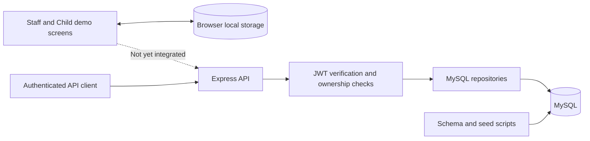

# Development Team Implementation Report

> **Integration update ? November 17, 2026:** The detailed audit below describes application commit `157e69e` before frontend integration. The current working tree now connects all 26 existing endpoints and adds atomic schedule saving, with real browser validation across all 27 method/path combinations. Authentication, profiles, task completion, cards, progress and settings now use the backend. See the [current endpoint integration record](ENDPOINT_CROSS_REFERENCE.md) for updated behavior, tests and remaining limits. The historical requirement totals below must not be read as a fresh assessment of this newer working tree.

**Project:** Web-Based Visual Schedule, Task Management and Communication System for Children with Developmental Delays

**Review/update date:** November 16, 2026 (Asia/Singapore)

**Analyzed application commit:** `157e69ea3c940a6443f239937d4a9c1d74436853`

**Requirements baseline:** Current `docs/SRS.md`, whose header identifies Version 1.0 (Draft), November 13, 2026. This report does not revise the SRS.

**Audience:** Development, SRS and Research teams

The backend now provides real authentication and MySQL-backed feature APIs. The browser provides substantial Staff and Child demo workflows, but those screens still use local state/browser storage instead of the backend. An implemented API and a working demo screen do not together establish an integrated, authenticated product workflow.

This update replaces the earlier snapshot assessment at `d363a23f83906eee4d47112c15cd5809c8c28079`. Missing-authentication, missing-screen and array-only-backend claims from that snapshot no longer describe the analyzed application.

## 1. Review method and evidence boundaries

- Account for all **114 distinct SRS IDs**: **96 behavioral/use-case IDs** and **18 category labels**. Each behavioral ID has a detailed assessment below. Requirement wording and priority/actor are taken from the current SRS tables and bullets; no priority is invented where that section does not state one.
- Separate backend implementation from browser implementation. A workflow remains partial when its required authenticated/persistent browser path is not connected, even if both components exist.
- **Correctly Implemented** means the stated, bounded behavior is supported by source and any cited tests. It is not a browser certification, security audit or claim that related workflows are complete.
- **Partially Implemented / Ongoing** identifies a present implementation with missing behavior/integration/evidence. “Ongoing” does not assert that someone is actively assigned.
- **Implemented with Drift** identifies a concrete mismatch with the stated behavior. **Not Implemented** identifies absent behavior. **Cannot Verify** applies to measured/process targets without sufficient evidence.
- Category labels are inventory headings, not independently testable behaviors. They remain Cannot Verify and are excluded from behavioral totals. Could/out-of-MVP absences are explicitly identified rather than counted as mandatory release failures.
- Source links below are regenerated against files in the analyzed checkout. The update changes this report only; it does not implement or change application behavior.

### Verification ledger

| Check | Evidence and boundary |
| --- | --- |
| Latest code-review recheck, November 16 | Non-database API run: **14 files, 166 passed, 2 TODOs**. Excluded `tests/group1/db.test.ts`, `schema.test.ts`, `seed.test.ts`, and `tests/group2/user-repository.test.ts`. Workspace typechecks passed. These results were obtained immediately before this documentation update at the same application commit. |
| Earlier implementation validation, same commit | **23 database tests** and **2 live MySQL integration tests** passed using an isolated MySQL instance; combined with the 166 above, **191 distinct tests passed**. Production build passed. This is recorded earlier session evidence, not a new database/build run for this report update. |
| Live integration coverage | API process restart, persisted completion/progress, database activity reads, cross-user access rejection, foreign-key cascades, preserved foreign/default records, completion undo, task removal/resequencing, failed-copy rollback/retry and duplicate-date conflicts. |
| Browser acceptance | Speech/phrase behavior and responsive layout remain two TODOs in the API acceptance suite. API-level tests named after acceptance items do not execute the browser or establish full SRS acceptance. |
| Not performed for this update | No new database mutation, browser/device speech run, keyboard/screen-reader audit, contrast measurement, load test, timed usability study or SUS study. No fresh assertion about upstream merge/deployment state. |
| Documentation checks | All SRS IDs, per-status totals, local link targets and line anchors are checked programmatically after generation. |

Relevant evidence: [apps/api/src/db/feature-data.integration.test.ts:201](../apps/api/src/db/feature-data.integration.test.ts#L201); [apps/api/src/db/feature-data.integration.test.ts:417](../apps/api/src/db/feature-data.integration.test.ts#L417); [apps/api/tests/group1/seed.test.ts:1](../apps/api/tests/group1/seed.test.ts#L1); [apps/api/tests/group5/acceptance.test.ts:1](../apps/api/tests/group5/acceptance.test.ts#L1); [.github/workflows/api-tests.yml:53](../.github/workflows/api-tests.yml#L53).

For reproducibility, the non-database recheck used:

```powershell
npm.cmd test -w @starter/api -- --exclude tests/group1/db.test.ts --exclude tests/group1/schema.test.ts --exclude tests/group1/seed.test.ts --exclude tests/group2/user-repository.test.ts
npm.cmd run typecheck
```

Database commands and their dedicated test-database requirements are documented in [README.md:57](../README.md#L57). Never run the database-resetting suites against application data.

## 2. Requirement traceability and detailed findings

### Authentication and account (FR-AUTH)

| ID | Requirement / use case | Assessment |
| --- | --- | --- |
| [FR-AUTH-01](#fr-auth-01) | The system shall allow a Staff member to register with name, email, password and role (Caregiver, OT or SPED Teacher). | Partially Implemented / Ongoing |
| [FR-AUTH-02](#fr-auth-02) | The system shall validate registration input (valid email format, minimum password length of 8 characters, required fields) and reject duplicate emails. | Partially Implemented / Ongoing |
| [FR-AUTH-03](#fr-auth-03) | The system shall store passwords only as salted hashes (e.g., bcrypt). | Correctly Implemented |
| [FR-AUTH-04](#fr-auth-04) | The system shall allow registered Staff to log in with email and password and receive a JWT. | Partially Implemented / Ongoing |
| [FR-AUTH-05](#fr-auth-05) | The system shall protect all non-public API routes and pages so that only authenticated users can access them. | Implemented with Drift |
| [FR-AUTH-06](#fr-auth-06) | The system shall allow the user to log out, clearing the stored token. | Partially Implemented / Ongoing |
| [FR-AUTH-07](#fr-auth-07) | The system shall handle an expired or invalid token by returning the user to the login page with a clear message. | Partially Implemented / Ongoing |
| [FR-AUTH-08](#fr-auth-08) | The system shall offer a "Remember me" option on login. | Not Implemented |

#### FR-AUTH-01

| Traceability field | Finding |
| --- | --- |
| SRS requires | The system shall allow a Staff member to register with name, email, password and role (Caregiver, OT or SPED Teacher). ([docs/SRS.md:147](SRS.md#L147); priority: Must) |
| Implementation status | **Partially Implemented / Ongoing** |
| Backend | Registration validates input and inserts a MySQL user, returning public profile fields. |
| Browser / demo UI | The registration form records a display name locally and navigates to the dashboard; it does not register an account. |
| Remaining work / limits | Connect the form to registration and surface server validation and duplicate-email failures. |
| Source evidence | [apps/api/src/routes/auth.ts:19](../apps/api/src/routes/auth.ts#L19); [apps/api/src/routes/auth.ts:32](../apps/api/src/routes/auth.ts#L32); [apps/api/src/middleware/requireAuth.ts:29](../apps/api/src/middleware/requireAuth.ts#L29); [apps/web/src/App.tsx:73](../apps/web/src/App.tsx#L73) |
| Related verification | [apps/api/tests/group2/auth.test.ts:1](../apps/api/tests/group2/auth.test.ts#L1); [apps/api/tests/group2/user-repository.test.ts:1](../apps/api/tests/group2/user-repository.test.ts#L1). These are backend/API tests, not browser interaction tests. |

#### FR-AUTH-02

| Traceability field | Finding |
| --- | --- |
| SRS requires | The system shall validate registration input (valid email format, minimum password length of 8 characters, required fields) and reject duplicate emails. ([docs/SRS.md:148](SRS.md#L148); priority: Must) |
| Implementation status | **Partially Implemented / Ongoing** |
| Backend | Zod validates required fields, email, role and password length; duplicate accounts return 409. |
| Browser / demo UI | Required inputs and a minimum-length check exist, but duplicate-account feedback cannot work without API integration. |
| Remaining work / limits | Use server validation results in the form; align client/server limits. |
| Source evidence | [apps/api/src/routes/auth.ts:19](../apps/api/src/routes/auth.ts#L19); [apps/api/src/auth/schemas.ts:7](../apps/api/src/auth/schemas.ts#L7); [apps/web/src/App.tsx:73](../apps/web/src/App.tsx#L73) |
| Related verification | [apps/api/tests/group2/auth.test.ts:1](../apps/api/tests/group2/auth.test.ts#L1); [apps/api/tests/group2/user-repository.test.ts:1](../apps/api/tests/group2/user-repository.test.ts#L1). These are backend/API tests, not browser interaction tests. |

#### FR-AUTH-03

| Traceability field | Finding |
| --- | --- |
| SRS requires | The system shall store passwords only as salted hashes (e.g., bcrypt). ([docs/SRS.md:149](SRS.md#L149); priority: Must) |
| Implementation status | **Correctly Implemented** |
| Backend | Registration hashes passwords with bcrypt at cost 12; login compares hashes. Passwordless demo seed accounts cannot log in. |
| Browser / demo UI | The demo form does not store a password or submit one to an account service. |
| Remaining work / limits | Preserve hashing when connecting the UI. This verdict concerns password storage, not a completed registration workflow. |
| Source evidence | [apps/api/src/routes/auth.ts:19](../apps/api/src/routes/auth.ts#L19); [apps/api/src/routes/auth.ts:32](../apps/api/src/routes/auth.ts#L32) |
| Related verification | [apps/api/tests/group2/auth.test.ts:1](../apps/api/tests/group2/auth.test.ts#L1); [apps/api/tests/group2/user-repository.test.ts:1](../apps/api/tests/group2/user-repository.test.ts#L1). These are backend/API tests, not browser interaction tests. |

#### FR-AUTH-04

| Traceability field | Finding |
| --- | --- |
| SRS requires | The system shall allow registered Staff to log in with email and password and receive a JWT. ([docs/SRS.md:150](SRS.md#L150); priority: Must) |
| Implementation status | **Partially Implemented / Ongoing** |
| Backend | Successful login issues an HS256 JWT with an eight-hour expiry and a user subject. |
| Browser / demo UI | Login currently accepts the form submission as a demo navigation action. |
| Remaining work / limits | Wire login, token storage and authenticated requests; handle incorrect credentials. |
| Source evidence | [apps/api/src/routes/auth.ts:32](../apps/api/src/routes/auth.ts#L32); [apps/api/src/config.ts:1](../apps/api/src/config.ts#L1); [apps/web/src/App.tsx:73](../apps/web/src/App.tsx#L73) |
| Related verification | [apps/api/tests/group2/auth.test.ts:1](../apps/api/tests/group2/auth.test.ts#L1). These are backend/API tests, not browser interaction tests. |

#### FR-AUTH-05

| Traceability field | Finding |
| --- | --- |
| SRS requires | The system shall protect all non-public API routes and pages so that only authenticated users can access them. ([docs/SRS.md:151](SRS.md#L151); priority: Must) |
| Implementation status | **Implemented with Drift** |
| Backend | All feature routers use JWT verification and database-backed user lookup; health and register/login are public. |
| Browser / demo UI | Hash navigation opens staff and child pages without an authenticated session. |
| Remaining work / limits | Protect browser routes and establish a real session. Backend authentication does not protect the currently disconnected demo pages. |
| Source evidence | [apps/api/src/app.ts:32](../apps/api/src/app.ts#L32); [apps/api/src/middleware/requireAuth.ts:29](../apps/api/src/middleware/requireAuth.ts#L29); [apps/web/src/App.tsx:63](../apps/web/src/App.tsx#L63); [apps/web/src/App.tsx:73](../apps/web/src/App.tsx#L73) |
| Related verification | [apps/api/tests/group2/auth.test.ts:1](../apps/api/tests/group2/auth.test.ts#L1); [apps/api/src/db/feature-data.integration.test.ts:201](../apps/api/src/db/feature-data.integration.test.ts#L201). These are backend/API tests, not browser interaction tests. |

#### FR-AUTH-06

| Traceability field | Finding |
| --- | --- |
| SRS requires | The system shall allow the user to log out, clearing the stored token. ([docs/SRS.md:152](SRS.md#L152); priority: Must) |
| Implementation status | **Partially Implemented / Ongoing** |
| Backend | JWTs are stateless; logout is intended to clear client credentials rather than require a server endpoint. |
| Browser / demo UI | Log out navigates to the login screen; no real token is stored or cleared. |
| Remaining work / limits | Clear the eventual token/session state and prevent protected navigation after logout. |
| Source evidence | [apps/web/src/App.tsx:73](../apps/web/src/App.tsx#L73); [apps/web/src/App.tsx:121](../apps/web/src/App.tsx#L121) |
| Related verification | [apps/api/tests/group5/acceptance.test.ts:1](../apps/api/tests/group5/acceptance.test.ts#L1). These are backend/API tests, not browser interaction tests. |

#### FR-AUTH-07

| Traceability field | Finding |
| --- | --- |
| SRS requires | The system shall handle an expired or invalid token by returning the user to the login page with a clear message. ([docs/SRS.md:153](SRS.md#L153); priority: Should) |
| Implementation status | **Partially Implemented / Ongoing** |
| Backend | Missing, malformed, expired and wrongly signed tokens return 401. |
| Browser / demo UI | There is no shared authenticated client or expired-session redirect. |
| Remaining work / limits | Handle 401 centrally, clear credentials and show a plain-language login message. |
| Source evidence | [apps/api/src/middleware/requireAuth.ts:29](../apps/api/src/middleware/requireAuth.ts#L29); [apps/web/src/App.tsx:73](../apps/web/src/App.tsx#L73); [apps/web/src/lib/api.ts:3](../apps/web/src/lib/api.ts#L3) |
| Related verification | [apps/api/tests/group2/auth.test.ts:1](../apps/api/tests/group2/auth.test.ts#L1). These are backend/API tests, not browser interaction tests. |

#### FR-AUTH-08

| Traceability field | Finding |
| --- | --- |
| SRS requires | The system shall offer a "Remember me" option on login. ([docs/SRS.md:154](SRS.md#L154); priority: Could) |
| Implementation status | **Not Implemented** |
| Backend | No server-side remembered-session policy is provided. |
| Browser / demo UI | The login form has no Remember me option or token persistence policy. |
| Remaining work / limits | Optional Could feature; define storage and expiry semantics if retained. |
| Source evidence | [apps/web/src/App.tsx:73](../apps/web/src/App.tsx#L73); [apps/api/src/config.ts:1](../apps/api/src/config.ts#L1) |
| Related verification | No dedicated automated browser/measurement test establishes this requirement; assessment is based on the cited source. |

### Child profile management (FR-CHILD)

| ID | Requirement / use case | Assessment |
| --- | --- | --- |
| [FR-CHILD-01](#fr-child-01) | The system shall allow Staff to create a child profile with name (or nickname), age, delay domain (e.g., speech, motor, cognitive, social, general) and optional notes. | Partially Implemented / Ongoing |
| [FR-CHILD-02](#fr-child-02) | The system shall allow Staff to view a list of their child profiles on the dashboard. | Partially Implemented / Ongoing |
| [FR-CHILD-03](#fr-child-03) | The system shall allow Staff to edit a child profile. | Partially Implemented / Ongoing |
| [FR-CHILD-04](#fr-child-04) | The system shall allow Staff to delete a child profile after confirmation; related schedules and tasks shall be deleted with it. | Partially Implemented / Ongoing |
| [FR-CHILD-05](#fr-child-05) | The system shall let a child profile use a predefined avatar (icon/emoji) instead of a photo. | Correctly Implemented |
| [FR-CHILD-06](#fr-child-06) | The system shall restrict each Staff member to the child profiles they created (data isolation). | Partially Implemented / Ongoing |

#### FR-CHILD-01

| Traceability field | Finding |
| --- | --- |
| SRS requires | The system shall allow Staff to create a child profile with name (or nickname), age, delay domain (e.g., speech, motor, cognitive, social, general) and optional notes. ([docs/SRS.md:160](SRS.md#L160); priority: Must) |
| Implementation status | **Partially Implemented / Ongoing** |
| Backend | Owned child creation persists name, age, delay domain, notes and avatar with parameterized SQL. |
| Browser / demo UI | Add-child forms update local application data. |
| Remaining work / limits | Connect creation to the API; map camelCase domain and asset-based avatars to the server contract. |
| Source evidence | [apps/api/src/routes/children.ts:15](../apps/api/src/routes/children.ts#L15); [apps/api/src/db/feature-data.ts:82](../apps/api/src/db/feature-data.ts#L82); [apps/web/src/StaffPages.tsx:109](../apps/web/src/StaffPages.tsx#L109); [apps/web/src/StaffPages.tsx:125](../apps/web/src/StaffPages.tsx#L125); [apps/web/src/App.tsx:121](../apps/web/src/App.tsx#L121) |
| Related verification | [apps/api/tests/group3/children.test.ts:1](../apps/api/tests/group3/children.test.ts#L1); [apps/api/src/db/feature-data.integration.test.ts:201](../apps/api/src/db/feature-data.integration.test.ts#L201). These are backend/API tests, not browser interaction tests. |

#### FR-CHILD-02

| Traceability field | Finding |
| --- | --- |
| SRS requires | The system shall allow Staff to view a list of their child profiles on the dashboard. ([docs/SRS.md:161](SRS.md#L161); priority: Must) |
| Implementation status | **Partially Implemented / Ongoing** |
| Backend | GET /api/children lists only the authenticated user's database children. |
| Browser / demo UI | Dashboard and profile lists render locally stored demo children. |
| Remaining work / limits | Populate the screens from the authenticated user's server response. |
| Source evidence | [apps/api/src/routes/children.ts:15](../apps/api/src/routes/children.ts#L15); [apps/api/src/db/feature-data.ts:82](../apps/api/src/db/feature-data.ts#L82); [apps/web/src/StaffPages.tsx:82](../apps/web/src/StaffPages.tsx#L82) |
| Related verification | [apps/api/tests/group3/children.test.ts:1](../apps/api/tests/group3/children.test.ts#L1); [apps/api/src/db/feature-data.integration.test.ts:201](../apps/api/src/db/feature-data.integration.test.ts#L201). These are backend/API tests, not browser interaction tests. |

#### FR-CHILD-03

| Traceability field | Finding |
| --- | --- |
| SRS requires | The system shall allow Staff to edit a child profile. ([docs/SRS.md:162](SRS.md#L162); priority: Must) |
| Implementation status | **Partially Implemented / Ongoing** |
| Backend | Owned partial updates are validated and persisted. |
| Browser / demo UI | Edit forms modify local child objects. |
| Remaining work / limits | Use API updates and reconcile state only after a successful response. |
| Source evidence | [apps/api/src/routes/children.ts:15](../apps/api/src/routes/children.ts#L15); [apps/api/src/db/feature-data.ts:82](../apps/api/src/db/feature-data.ts#L82); [apps/web/src/StaffPages.tsx:109](../apps/web/src/StaffPages.tsx#L109); [apps/web/src/StaffPages.tsx:125](../apps/web/src/StaffPages.tsx#L125); [apps/web/src/App.tsx:121](../apps/web/src/App.tsx#L121) |
| Related verification | [apps/api/tests/group3/children.test.ts:1](../apps/api/tests/group3/children.test.ts#L1); [apps/api/src/db/feature-data.integration.test.ts:201](../apps/api/src/db/feature-data.integration.test.ts#L201). These are backend/API tests, not browser interaction tests. |

#### FR-CHILD-04

| Traceability field | Finding |
| --- | --- |
| SRS requires | The system shall allow Staff to delete a child profile after confirmation; related schedules and tasks shall be deleted with it. ([docs/SRS.md:163](SRS.md#L163); priority: Must) |
| Implementation status | **Partially Implemented / Ongoing** |
| Backend | Owned deletion relies on verified foreign-key cascades for schedules, tasks and custom cards. |
| Browser / demo UI | A confirmation view deletes local children, schedules and custom cards. |
| Remaining work / limits | Connect confirmed deletion to the API and keep local data until server success. |
| Source evidence | [apps/api/src/routes/children.ts:15](../apps/api/src/routes/children.ts#L15); [apps/api/src/db/feature-data.ts:82](../apps/api/src/db/feature-data.ts#L82); [apps/web/src/StaffPages.tsx:109](../apps/web/src/StaffPages.tsx#L109); [apps/web/src/StaffPages.tsx:125](../apps/web/src/StaffPages.tsx#L125); [apps/web/src/App.tsx:121](../apps/web/src/App.tsx#L121) |
| Related verification | [apps/api/tests/group3/children.test.ts:1](../apps/api/tests/group3/children.test.ts#L1); [apps/api/src/db/feature-data.integration.test.ts:201](../apps/api/src/db/feature-data.integration.test.ts#L201). These are backend/API tests, not browser interaction tests. |

#### FR-CHILD-05

| Traceability field | Finding |
| --- | --- |
| SRS requires | The system shall let a child profile use a predefined avatar (icon/emoji) instead of a photo. ([docs/SRS.md:164](SRS.md#L164); priority: Should) |
| Implementation status | **Correctly Implemented** |
| Backend | Child schemas allow predefined emoji avatars and supply a default. |
| Browser / demo UI | The form offers predefined illustrated avatars without photo upload. |
| Remaining work / limits | The isolated avatar behavior exists; adapt the different avatar representations during integration. |
| Source evidence | [packages/shared/src/schemas.ts:1](../packages/shared/src/schemas.ts#L1); [apps/web/src/StaffPages.tsx:109](../apps/web/src/StaffPages.tsx#L109) |
| Related verification | [apps/api/tests/group3/children.test.ts:1](../apps/api/tests/group3/children.test.ts#L1). These are backend/API tests, not browser interaction tests. |

#### FR-CHILD-06

| Traceability field | Finding |
| --- | --- |
| SRS requires | The system shall restrict each Staff member to the child profiles they created (data isolation). ([docs/SRS.md:165](SRS.md#L165); priority: Must) |
| Implementation status | **Partially Implemented / Ongoing** |
| Backend | Owner-scoped SQL and descendant checks reject cross-user operations; live MySQL coverage verifies isolation. |
| Browser / demo UI | Browser demo data is shared within its storage namespace and is not tied to a logged-in account. |
| Remaining work / limits | Bind browser data and cache lifecycle to a real authenticated user; preserve API isolation checks. |
| Source evidence | [apps/api/src/routes/children.ts:15](../apps/api/src/routes/children.ts#L15); [apps/api/src/db/feature-data.ts:82](../apps/api/src/db/feature-data.ts#L82); [apps/web/src/StaffPages.tsx:109](../apps/web/src/StaffPages.tsx#L109); [apps/web/src/StaffPages.tsx:125](../apps/web/src/StaffPages.tsx#L125); [apps/web/src/App.tsx:121](../apps/web/src/App.tsx#L121) |
| Related verification | [apps/api/tests/group3/children.test.ts:1](../apps/api/tests/group3/children.test.ts#L1); [apps/api/src/db/feature-data.integration.test.ts:201](../apps/api/src/db/feature-data.integration.test.ts#L201). These are backend/API tests, not browser interaction tests. |

### Visual schedule creator (FR-SCH)

| ID | Requirement / use case | Assessment |
| --- | --- | --- |
| [FR-SCH-01](#fr-sch-01) | The system shall provide a predefined activity library (e.g., wake up, brush teeth, wash hands, eat breakfast, get dressed, toilet, go to school, learning activity, play, bath, get ready for bed), each with an icon and category (hygiene, food, school, play, other). | Correctly Implemented |
| [FR-SCH-02](#fr-sch-02) | The system shall let Staff create a schedule for a selected child for a selected date by adding activities from the library. | Partially Implemented / Ongoing |
| [FR-SCH-03](#fr-sch-03) | The system shall let Staff add activities by drag-and-drop and by an "Add" button, so the feature still works on touch devices. | Partially Implemented / Ongoing |
| [FR-SCH-04](#fr-sch-04) | The system shall let Staff reorder activities within a schedule. | Partially Implemented / Ongoing |
| [FR-SCH-05](#fr-sch-05) | The system shall let Staff set, per activity, an optional start time and a duration in minutes. | Partially Implemented / Ongoing |
| [FR-SCH-06](#fr-sch-06) | The system shall let Staff remove an activity from a schedule. | Partially Implemented / Ongoing |
| [FR-SCH-07](#fr-sch-07) | The system shall show activities color-coded by category. | Correctly Implemented |
| [FR-SCH-08](#fr-sch-08) | The system shall let Staff create a custom text activity (name plus a chosen icon from a predefined set). | Partially Implemented / Ongoing |
| [FR-SCH-09](#fr-sch-09) | The system shall let Staff copy a schedule from another date (e.g., previous day) to a new date. | Partially Implemented / Ongoing |
| [FR-SCH-10](#fr-sch-10) | The system shall provide a preview of the schedule as the child will see it. | Implemented with Drift |

#### FR-SCH-01

| Traceability field | Finding |
| --- | --- |
| SRS requires | The system shall provide a predefined activity library (e.g., wake up, brush teeth, wash hands, eat breakfast, get dressed, toilet, go to school, learning activity, play, bath, get ready for bed), each with an icon and category (hygiene, food, school, play, other). ([docs/SRS.md:171](SRS.md#L171); priority: Must) |
| Implementation status | **Correctly Implemented** |
| Backend | GET /api/activities serves the seeded MySQL activity library. |
| Browser / demo UI | An eleven-item local library provides activity names, icons and categories. |
| Remaining work / limits | The library behavior exists. Replace the independent browser library with server data during integration. |
| Source evidence | [apps/api/src/routes/activities.ts:7](../apps/api/src/routes/activities.ts#L7); [apps/api/scripts/seed.ts:79](../apps/api/scripts/seed.ts#L79); [apps/web/src/SchedulePages.tsx:51](../apps/web/src/SchedulePages.tsx#L51) |
| Related verification | [apps/api/tests/group3/activities.test.ts:1](../apps/api/tests/group3/activities.test.ts#L1); [apps/api/tests/group1/seed.test.ts:1](../apps/api/tests/group1/seed.test.ts#L1); [apps/api/src/db/feature-data.integration.test.ts:201](../apps/api/src/db/feature-data.integration.test.ts#L201). These are backend/API tests, not browser interaction tests. |

#### FR-SCH-02

| Traceability field | Finding |
| --- | --- |
| SRS requires | The system shall let Staff create a schedule for a selected child for a selected date by adding activities from the library. ([docs/SRS.md:172](SRS.md#L172); priority: Must) |
| Implementation status | **Partially Implemented / Ongoing** |
| Backend | Child/date schedules and tasks persist; duplicates return 409. |
| Browser / demo UI | The editor selects a child/date, adds activities and saves into local state. |
| Remaining work / limits | Implement authenticated API-backed loading and saving without losing draft changes. |
| Source evidence | [apps/api/src/routes/schedules.ts:23](../apps/api/src/routes/schedules.ts#L23); [apps/api/src/db/feature-data.ts:235](../apps/api/src/db/feature-data.ts#L235); [apps/web/src/SchedulePages.tsx:51](../apps/web/src/SchedulePages.tsx#L51) |
| Related verification | [apps/api/tests/group4/schedules.test.ts:1](../apps/api/tests/group4/schedules.test.ts#L1); [apps/api/src/db/feature-data.integration.test.ts:201](../apps/api/src/db/feature-data.integration.test.ts#L201). These are backend/API tests, not browser interaction tests. |

#### FR-SCH-03

| Traceability field | Finding |
| --- | --- |
| SRS requires | The system shall let Staff add activities by drag-and-drop and by an "Add" button, so the feature still works on touch devices. ([docs/SRS.md:173](SRS.md#L173); priority: Must) |
| Implementation status | **Partially Implemented / Ongoing** |
| Backend | Task creation supports adding an activity; drag/drop is a browser concern. |
| Browser / demo UI | Add buttons work. A drag instruction and grip are displayed, but no draggable/onDrag/onDrop handlers exist. |
| Remaining work / limits | Implement drag/drop with keyboard/touch alternatives or agree an SRS revision; Add alone does not satisfy the stated conjunction. |
| Source evidence | [apps/web/src/SchedulePages.tsx:51](../apps/web/src/SchedulePages.tsx#L51) |
| Related verification | [apps/api/tests/group4/schedules.test.ts:1](../apps/api/tests/group4/schedules.test.ts#L1). These are backend/API tests, not browser interaction tests. |

#### FR-SCH-04

| Traceability field | Finding |
| --- | --- |
| SRS requires | The system shall let Staff reorder activities within a schedule. ([docs/SRS.md:174](SRS.md#L174); priority: Must) |
| Implementation status | **Partially Implemented / Ongoing** |
| Backend | Transactional reordering maintains unique positions and locks the parent schedule. |
| Browser / demo UI | Move up/down changes the local draft order. |
| Remaining work / limits | Persist browser reordering through the API and test both movement directions against MySQL. |
| Source evidence | [apps/api/src/routes/tasks.ts:25](../apps/api/src/routes/tasks.ts#L25); [apps/api/src/db/feature-data.ts:82](../apps/api/src/db/feature-data.ts#L82); [apps/web/src/SchedulePages.tsx:51](../apps/web/src/SchedulePages.tsx#L51) |
| Related verification | [apps/api/tests/group4/tasks.test.ts:1](../apps/api/tests/group4/tasks.test.ts#L1); [apps/api/src/db/feature-data.integration.test.ts:201](../apps/api/src/db/feature-data.integration.test.ts#L201). These are backend/API tests, not browser interaction tests. |

#### FR-SCH-05

| Traceability field | Finding |
| --- | --- |
| SRS requires | The system shall let Staff set, per activity, an optional start time and a duration in minutes. ([docs/SRS.md:175](SRS.md#L175); priority: Must) |
| Implementation status | **Partially Implemented / Ongoing** |
| Backend | Task updates accept optional HH:MM time and nullable duration; server duration is restricted to 1–1440. |
| Browser / demo UI | Draft time/duration controls exist. The handler checks positive integers but does not enforce the server maximum itself. |
| Remaining work / limits | Map fields and enforce consistent limits before submitting the API update. |
| Source evidence | [packages/shared/src/schemas.ts:1](../packages/shared/src/schemas.ts#L1); [apps/api/src/routes/tasks.ts:25](../apps/api/src/routes/tasks.ts#L25); [apps/web/src/SchedulePages.tsx:51](../apps/web/src/SchedulePages.tsx#L51) |
| Related verification | [apps/api/tests/group4/tasks.test.ts:1](../apps/api/tests/group4/tasks.test.ts#L1). These are backend/API tests, not browser interaction tests. |

#### FR-SCH-06

| Traceability field | Finding |
| --- | --- |
| SRS requires | The system shall let Staff remove an activity from a schedule. ([docs/SRS.md:176](SRS.md#L176); priority: Must) |
| Implementation status | **Partially Implemented / Ongoing** |
| Backend | Task deletion persists and resequences remaining tasks transactionally. |
| Browser / demo UI | Remove buttons delete local draft activities. |
| Remaining work / limits | Connect draft removal/save behavior to server deletion with recoverable failures. |
| Source evidence | [apps/api/src/routes/tasks.ts:25](../apps/api/src/routes/tasks.ts#L25); [apps/api/src/db/feature-data.ts:82](../apps/api/src/db/feature-data.ts#L82); [apps/web/src/SchedulePages.tsx:51](../apps/web/src/SchedulePages.tsx#L51) |
| Related verification | [apps/api/tests/group4/tasks.test.ts:1](../apps/api/tests/group4/tasks.test.ts#L1); [apps/api/src/db/feature-data.integration.test.ts:201](../apps/api/src/db/feature-data.integration.test.ts#L201). These are backend/API tests, not browser interaction tests. |

#### FR-SCH-07

| Traceability field | Finding |
| --- | --- |
| SRS requires | The system shall show activities color-coded by category. ([docs/SRS.md:177](SRS.md#L177); priority: Should) |
| Implementation status | **Correctly Implemented** |
| Backend | Library activities carry categories. |
| Browser / demo UI | Category chips have category-specific styles and accompanying text. |
| Remaining work / limits | This category-display behavior exists; visual contrast still requires measurement. |
| Source evidence | [apps/web/src/SchedulePages.tsx:51](../apps/web/src/SchedulePages.tsx#L51); [apps/web/src/schedule.css:1](../apps/web/src/schedule.css#L1) |
| Related verification | No dedicated automated browser/measurement test establishes this requirement; assessment is based on the cited source. |

#### FR-SCH-08

| Traceability field | Finding |
| --- | --- |
| SRS requires | The system shall let Staff create a custom text activity (name plus a chosen icon from a predefined set). ([docs/SRS.md:178](SRS.md#L178); priority: Should) |
| Implementation status | **Partially Implemented / Ongoing** |
| Backend | Custom tasks accept a name and an allowlisted emoji icon with no library activity reference. |
| Browser / demo UI | Custom-activity forms use illustrated asset paths and a local category. |
| Remaining work / limits | Adapt icon and field representations; a browser asset path is not a valid backend emoji icon. |
| Source evidence | [packages/shared/src/schemas.ts:1](../packages/shared/src/schemas.ts#L1); [apps/api/src/routes/tasks.ts:25](../apps/api/src/routes/tasks.ts#L25); [apps/web/src/SchedulePages.tsx:51](../apps/web/src/SchedulePages.tsx#L51) |
| Related verification | [apps/api/tests/group4/tasks.test.ts:1](../apps/api/tests/group4/tasks.test.ts#L1). These are backend/API tests, not browser interaction tests. |

#### FR-SCH-09

| Traceability field | Finding |
| --- | --- |
| SRS requires | The system shall let Staff copy a schedule from another date (e.g., previous day) to a new date. ([docs/SRS.md:179](SRS.md#L179); priority: Should) |
| Implementation status | **Partially Implemented / Ongoing** |
| Backend | Schedule and copied tasks commit together; copies preserve timing/order and reset completion. |
| Browser / demo UI | Copy-from-date creates a local draft with new task IDs and pending status. |
| Remaining work / limits | Connect the copy flow and verify server conflict/failure recovery in the browser. |
| Source evidence | [apps/api/src/db/feature-data.ts:235](../apps/api/src/db/feature-data.ts#L235); [apps/web/src/SchedulePages.tsx:51](../apps/web/src/SchedulePages.tsx#L51) |
| Related verification | [apps/api/tests/group4/schedules.test.ts:1](../apps/api/tests/group4/schedules.test.ts#L1); [apps/api/src/db/feature-data.integration.test.ts:201](../apps/api/src/db/feature-data.integration.test.ts#L201); [apps/api/src/db/feature-data.integration.test.ts:417](../apps/api/src/db/feature-data.integration.test.ts#L417). These are backend/API tests, not browser interaction tests. |

#### FR-SCH-10

| Traceability field | Finding |
| --- | --- |
| SRS requires | The system shall provide a preview of the schedule as the child will see it. ([docs/SRS.md:180](SRS.md#L180); priority: Should) |
| Implementation status | **Implemented with Drift** |
| Backend | The API can load a selected date's saved schedule. |
| Browser / demo UI | Preview opens Child view, which reads today's saved schedule rather than the selected date and current draft. |
| Remaining work / limits | Pass a preview snapshot/date or clearly restrict preview to a saved schedule for today. |
| Source evidence | [apps/web/src/SchedulePages.tsx:51](../apps/web/src/SchedulePages.tsx#L51); [apps/web/src/ChildView.tsx:115](../apps/web/src/ChildView.tsx#L115); [apps/web/src/App.tsx:121](../apps/web/src/App.tsx#L121) |
| Related verification | No dedicated automated browser/measurement test establishes this requirement; assessment is based on the cited source. |

### Task management (FR-TASK)

| ID | Requirement / use case | Assessment |
| --- | --- | --- |
| [FR-TASK-01](#fr-task-01) | The system shall treat each activity in a schedule as a task with a status of pending or done. | Correctly Implemented |
| [FR-TASK-02](#fr-task-02) | The system shall let a task be marked as done from the Child view and from the Staff view. | Partially Implemented / Ongoing |
| [FR-TASK-03](#fr-task-03) | The system shall record the completion time of each completed task. | Partially Implemented / Ongoing |
| [FR-TASK-04](#fr-task-04) | The system shall let Staff undo a completion (set the task back to pending). | Partially Implemented / Ongoing |
| [FR-TASK-05](#fr-task-05) | The system shall show Staff the list of tasks for a child and date with their status. | Partially Implemented / Ongoing |
| [FR-TASK-06](#fr-task-06) | The system shall provide an optional visual countdown timer (color-coded circle or pie) for tasks with a duration, with a gentle visual cue near the end. | Not Implemented |
| [FR-TASK-07](#fr-task-07) | The system shall provide an optional sound cue when a timer ends, which can be turned off. | Not Implemented |

#### FR-TASK-01

| Traceability field | Finding |
| --- | --- |
| SRS requires | The system shall treat each activity in a schedule as a task with a status of pending or done. ([docs/SRS.md:186](SRS.md#L186); priority: Must) |
| Implementation status | **Correctly Implemented** |
| Backend | New tasks default to pending; completion/undo changes pending/done. |
| Browser / demo UI | The frontend task model and displays use the same two states. |
| Remaining work / limits | Maintain the shared status semantics during integration. |
| Source evidence | [apps/api/src/routes/tasks.ts:25](../apps/api/src/routes/tasks.ts#L25); [apps/api/src/db/feature-data.ts:488](../apps/api/src/db/feature-data.ts#L488); [apps/web/src/model.ts:13](../apps/web/src/model.ts#L13) |
| Related verification | [apps/api/tests/group4/tasks.test.ts:1](../apps/api/tests/group4/tasks.test.ts#L1). These are backend/API tests, not browser interaction tests. |

#### FR-TASK-02

| Traceability field | Finding |
| --- | --- |
| SRS requires | The system shall let a task be marked as done from the Child view and from the Staff view. ([docs/SRS.md:187](SRS.md#L187); priority: Must) |
| Implementation status | **Partially Implemented / Ongoing** |
| Backend | An owned task can be completed through the API. |
| Browser / demo UI | Staff and Child controls both update local task status. |
| Remaining work / limits | Connect both actions to the same persisted completion endpoint. |
| Source evidence | [apps/api/src/routes/tasks.ts:25](../apps/api/src/routes/tasks.ts#L25); [apps/api/src/db/feature-data.ts:488](../apps/api/src/db/feature-data.ts#L488); [apps/web/src/SchedulePages.tsx:51](../apps/web/src/SchedulePages.tsx#L51); [apps/web/src/ChildView.tsx:115](../apps/web/src/ChildView.tsx#L115) |
| Related verification | [apps/api/tests/group4/tasks.test.ts:1](../apps/api/tests/group4/tasks.test.ts#L1); [apps/api/src/db/feature-data.integration.test.ts:201](../apps/api/src/db/feature-data.integration.test.ts#L201). These are backend/API tests, not browser interaction tests. |

#### FR-TASK-03

| Traceability field | Finding |
| --- | --- |
| SRS requires | The system shall record the completion time of each completed task. ([docs/SRS.md:188](SRS.md#L188); priority: Must) |
| Implementation status | **Partially Implemented / Ongoing** |
| Backend | First completion stores UTC time; repeated completion preserves it, and undo clears it. |
| Browser / demo UI | Browser ScheduleTask has no completion timestamp and markTask only changes status. |
| Remaining work / limits | Store the returned server timestamp and use it for recent history. |
| Source evidence | [apps/api/src/db/feature-data.ts:488](../apps/api/src/db/feature-data.ts#L488); [apps/web/src/model.ts:13](../apps/web/src/model.ts#L13); [apps/web/src/App.tsx:121](../apps/web/src/App.tsx#L121) |
| Related verification | [apps/api/tests/group4/tasks.test.ts:1](../apps/api/tests/group4/tasks.test.ts#L1); [apps/api/src/db/feature-data.integration.test.ts:201](../apps/api/src/db/feature-data.integration.test.ts#L201). These are backend/API tests, not browser interaction tests. |

#### FR-TASK-04

| Traceability field | Finding |
| --- | --- |
| SRS requires | The system shall let Staff undo a completion (set the task back to pending). ([docs/SRS.md:189](SRS.md#L189); priority: Should) |
| Implementation status | **Partially Implemented / Ongoing** |
| Backend | Undo restores pending and clears completed_at. |
| Browser / demo UI | Staff Task status offers Undo completion for local tasks. |
| Remaining work / limits | Persist the undo and reconcile the returned task. |
| Source evidence | [apps/api/src/db/feature-data.ts:488](../apps/api/src/db/feature-data.ts#L488); [apps/web/src/SchedulePages.tsx:51](../apps/web/src/SchedulePages.tsx#L51) |
| Related verification | [apps/api/tests/group4/tasks.test.ts:1](../apps/api/tests/group4/tasks.test.ts#L1); [apps/api/src/db/feature-data.integration.test.ts:201](../apps/api/src/db/feature-data.integration.test.ts#L201). These are backend/API tests, not browser interaction tests. |

#### FR-TASK-05

| Traceability field | Finding |
| --- | --- |
| SRS requires | The system shall show Staff the list of tasks for a child and date with their status. ([docs/SRS.md:190](SRS.md#L190); priority: Must) |
| Implementation status | **Partially Implemented / Ongoing** |
| Backend | Owned child/date schedule reads return tasks in position order with statuses. |
| Browser / demo UI | Staff Task status renders the selected local schedule. |
| Remaining work / limits | Load and refresh task status from the API. |
| Source evidence | [apps/api/src/routes/schedules.ts:23](../apps/api/src/routes/schedules.ts#L23); [apps/web/src/SchedulePages.tsx:51](../apps/web/src/SchedulePages.tsx#L51) |
| Related verification | [apps/api/tests/group4/schedules.test.ts:1](../apps/api/tests/group4/schedules.test.ts#L1); [apps/api/tests/group4/tasks.test.ts:1](../apps/api/tests/group4/tasks.test.ts#L1). These are backend/API tests, not browser interaction tests. |

#### FR-TASK-06

| Traceability field | Finding |
| --- | --- |
| SRS requires | The system shall provide an optional visual countdown timer (color-coded circle or pie) for tasks with a duration, with a gentle visual cue near the end. ([docs/SRS.md:191](SRS.md#L191); priority: Could) |
| Implementation status | **Not Implemented** |
| Backend | Duration is stored, but no countdown service is implemented. |
| Browser / demo UI | No countdown state, circle/pie or near-end cue exists. |
| Remaining work / limits | Optional Could feature; implement and test only if retained in scope. |
| Source evidence | [apps/web/src/SchedulePages.tsx:51](../apps/web/src/SchedulePages.tsx#L51); [apps/web/src/ChildView.tsx:115](../apps/web/src/ChildView.tsx#L115) |
| Related verification | No dedicated automated browser/measurement test establishes this requirement; assessment is based on the cited source. |

#### FR-TASK-07

| Traceability field | Finding |
| --- | --- |
| SRS requires | The system shall provide an optional sound cue when a timer ends, which can be turned off. ([docs/SRS.md:192](SRS.md#L192); priority: Could) |
| Implementation status | **Not Implemented** |
| Backend | A sound preference can be stored, but there is no timer-end event. |
| Browser / demo UI | There is a schedule-sounds toggle but no timer or timer-end audio cue. |
| Remaining work / limits | Optional Could feature depends on a timer; a stored preference is not a functioning cue. |
| Source evidence | [apps/web/src/StaffPages.tsx:144](../apps/web/src/StaffPages.tsx#L144); [apps/web/src/ChildView.tsx:115](../apps/web/src/ChildView.tsx#L115) |
| Related verification | No dedicated automated browser/measurement test establishes this requirement; assessment is based on the cited source. |

### Child interface (FR-CHD)

| ID | Requirement / use case | Assessment |
| --- | --- | --- |
| [FR-CHD-01](#fr-chd-01) | The system shall let a signed-in Staff member open the Child view for a selected child; the child does not log in separately. | Partially Implemented / Ongoing |
| [FR-CHD-02](#fr-chd-02) | The Child view shall show the current day's tasks in order, using large icons, short labels and high-contrast colors. | Partially Implemented / Ongoing |
| [FR-CHD-03](#fr-chd-03) | The Child view shall highlight the current (next pending) task and show what comes next. | Implemented with Drift |
| [FR-CHD-04](#fr-chd-04) | The Child view shall let the child mark the current task as done with one large "Done" button. | Partially Implemented / Ongoing |
| [FR-CHD-05](#fr-chd-05) | The Child view shall show a clear positive confirmation when a task is completed (e.g., a checkmark and simple animation). | Correctly Implemented |
| [FR-CHD-06](#fr-chd-06) | The Child view shall show a simple completion indicator (e.g., "4 of 6 done") and a friendly message when all tasks are finished. | Correctly Implemented |
| [FR-CHD-07](#fr-chd-07) | The Child view shall contain no ads, external links or pop-ups, and shall provide navigation only between the schedule and the communication board. | Correctly Implemented |
| [FR-CHD-08](#fr-chd-08) | Leaving the Child view shall require a deliberate Staff action (e.g., a small "Exit" control in a corner, optionally protected by a 4-digit PIN). | Correctly Implemented |

#### FR-CHD-01

| Traceability field | Finding |
| --- | --- |
| SRS requires | The system shall let a signed-in Staff member open the Child view for a selected child; the child does not log in separately. ([docs/SRS.md:198](SRS.md#L198); priority: Must) |
| Implementation status | **Partially Implemented / Ongoing** |
| Backend | Feature data is protected by JWT authentication. |
| Browser / demo UI | Staff can select a child and open Child view, but without a real signed-in session. |
| Remaining work / limits | Connect child selection/data and enforce authenticated entry. |
| Source evidence | [apps/web/src/ChildView.tsx:115](../apps/web/src/ChildView.tsx#L115); [apps/api/src/middleware/requireAuth.ts:29](../apps/api/src/middleware/requireAuth.ts#L29); [apps/web/src/App.tsx:121](../apps/web/src/App.tsx#L121) |
| Related verification | [apps/api/tests/group2/auth.test.ts:1](../apps/api/tests/group2/auth.test.ts#L1); [apps/api/tests/group3/children.test.ts:1](../apps/api/tests/group3/children.test.ts#L1). These are backend/API tests, not browser interaction tests. |

#### FR-CHD-02

| Traceability field | Finding |
| --- | --- |
| SRS requires | The Child view shall show the current day's tasks in order, using large icons, short labels and high-contrast colors. ([docs/SRS.md:199](SRS.md#L199); priority: Must) |
| Implementation status | **Partially Implemented / Ongoing** |
| Backend | The API serves ordered tasks for a child/date. |
| Browser / demo UI | Child view renders today's local tasks using illustrations, short labels and a high-contrast mode. |
| Remaining work / limits | Load the persisted schedule and validate presentation on target devices. |
| Source evidence | [apps/web/src/ChildView.tsx:115](../apps/web/src/ChildView.tsx#L115); [apps/web/src/child.css:1](../apps/web/src/child.css#L1); [apps/api/src/routes/schedules.ts:23](../apps/api/src/routes/schedules.ts#L23) |
| Related verification | [apps/api/tests/group4/schedules.test.ts:1](../apps/api/tests/group4/schedules.test.ts#L1). These are backend/API tests, not browser interaction tests. |

#### FR-CHD-03

| Traceability field | Finding |
| --- | --- |
| SRS requires | The Child view shall highlight the current (next pending) task and show what comes next. ([docs/SRS.md:200](SRS.md#L200); priority: Must) |
| Implementation status | **Implemented with Drift** |
| Backend | Task ordering and statuses are available. |
| Browser / demo UI | Current is the first pending task, but Next is the immediately following array item, which may already be done after out-of-order staff completion. |
| Remaining work / limits | Choose the next pending task for Next and cover mixed-status sequences. |
| Source evidence | [apps/web/src/ChildView.tsx:115](../apps/web/src/ChildView.tsx#L115) |
| Related verification | No dedicated automated browser/measurement test establishes this requirement; assessment is based on the cited source. |

#### FR-CHD-04

| Traceability field | Finding |
| --- | --- |
| SRS requires | The Child view shall let the child mark the current task as done with one large "Done" button. ([docs/SRS.md:201](SRS.md#L201); priority: Must) |
| Implementation status | **Partially Implemented / Ongoing** |
| Backend | The completion endpoint persists status and time. |
| Browser / demo UI | One large Done button completes the current local task. |
| Remaining work / limits | Wire the button to the API with safe pending/error behavior. |
| Source evidence | [apps/web/src/ChildView.tsx:115](../apps/web/src/ChildView.tsx#L115); [apps/api/src/db/feature-data.ts:488](../apps/api/src/db/feature-data.ts#L488); [apps/web/src/App.tsx:121](../apps/web/src/App.tsx#L121) |
| Related verification | [apps/api/tests/group4/tasks.test.ts:1](../apps/api/tests/group4/tasks.test.ts#L1). These are backend/API tests, not browser interaction tests. |

#### FR-CHD-05

| Traceability field | Finding |
| --- | --- |
| SRS requires | The Child view shall show a clear positive confirmation when a task is completed (e.g., a checkmark and simple animation). ([docs/SRS.md:202](SRS.md#L202); priority: Should) |
| Implementation status | **Correctly Implemented** |
| Backend | The API returns the completed task; visual feedback is a browser responsibility. |
| Browser / demo UI | Completion displays a checkmark/message, and finishing all tasks displays All done. |
| Remaining work / limits | Source establishes feedback UI; child comprehension and animation quality have not been evaluated. |
| Source evidence | [apps/web/src/ChildView.tsx:115](../apps/web/src/ChildView.tsx#L115) |
| Related verification | No dedicated automated browser/measurement test establishes this requirement; assessment is based on the cited source. |

#### FR-CHD-06

| Traceability field | Finding |
| --- | --- |
| SRS requires | The Child view shall show a simple completion indicator (e.g., "4 of 6 done") and a friendly message when all tasks are finished. ([docs/SRS.md:203](SRS.md#L203); priority: Should) |
| Implementation status | **Correctly Implemented** |
| Backend | Counts are derivable from task statuses. |
| Browser / demo UI | Child view shows done/total and a friendly all-finished message. |
| Remaining work / limits | This local indicator behavior exists; it must reflect server state after integration. |
| Source evidence | [apps/web/src/ChildView.tsx:115](../apps/web/src/ChildView.tsx#L115) |
| Related verification | No dedicated automated browser/measurement test establishes this requirement; assessment is based on the cited source. |

#### FR-CHD-07

| Traceability field | Finding |
| --- | --- |
| SRS requires | The Child view shall contain no ads, external links or pop-ups, and shall provide navigation only between the schedule and the communication board. ([docs/SRS.md:204](SRS.md#L204); priority: Must) |
| Implementation status | **Correctly Implemented** |
| Backend | No special child-login endpoint is required. |
| Browser / demo UI | Child view offers My day and Talk navigation plus the deliberate exit path; no ads or external links are rendered by this component. |
| Remaining work / limits | This is a component-level navigation verdict, not authenticated route protection or a browser security boundary. |
| Source evidence | [apps/web/src/ChildView.tsx:115](../apps/web/src/ChildView.tsx#L115) |
| Related verification | No dedicated automated browser/measurement test establishes this requirement; assessment is based on the cited source. |

#### FR-CHD-08

| Traceability field | Finding |
| --- | --- |
| SRS requires | Leaving the Child view shall require a deliberate Staff action (e.g., a small "Exit" control in a corner, optionally protected by a 4-digit PIN). ([docs/SRS.md:205](SRS.md#L205); priority: Should) |
| Implementation status | **Correctly Implemented** |
| Backend | A PIN is optional under the current SRS. |
| Browser / demo UI | Exit opens a confirmation view with Stay and Return actions. |
| Remaining work / limits | The deliberate confirmation exists. It does not authenticate the adult; a PIN policy remains a team decision. |
| Source evidence | [apps/web/src/ChildView.tsx:178](../apps/web/src/ChildView.tsx#L178) |
| Related verification | No dedicated automated browser/measurement test establishes this requirement; assessment is based on the cited source. |

### Picture-based communication (FR-COMM)

| ID | Requirement / use case | Assessment |
| --- | --- | --- |
| [FR-COMM-01](#fr-comm-01) | The system shall provide a communication board of picture cards, each with an image/icon and a label. | Correctly Implemented |
| [FR-COMM-02](#fr-comm-02) | The system shall provide predefined cards grouped into categories, at minimum Food, Emotions, Activities and Needs (e.g., water, milk, rice, bread, happy, sad, tired, play, toilet, TV). | Correctly Implemented |
| [FR-COMM-03](#fr-comm-03) | When a card is tapped, the system shall speak its label aloud using text-to-speech. | Partially Implemented / Ongoing |
| [FR-COMM-04](#fr-comm-04) | The system shall let the child build a short phrase in a sentence bar (e.g., "I want" + card) and speak the whole phrase with one button. | Partially Implemented / Ongoing |
| [FR-COMM-05](#fr-comm-05) | The system shall let the child clear the sentence bar. | Correctly Implemented |
| [FR-COMM-06](#fr-comm-06) | The system shall let Staff add a card by entering a word to speak, choosing a category and choosing an icon from a predefined set. | Partially Implemented / Ongoing |
| [FR-COMM-07](#fr-comm-07) | The system shall let Staff hide or delete cards they added. | Partially Implemented / Ongoing |
| [FR-COMM-08](#fr-comm-08) | The system shall let Staff set the TTS voice speed. | Not Implemented |
| [FR-COMM-09](#fr-comm-09) | The system shall let Staff upload their own photo for a card. | Not Implemented |

#### FR-COMM-01

| Traceability field | Finding |
| --- | --- |
| SRS requires | The system shall provide a communication board of picture cards, each with an image/icon and a label. ([docs/SRS.md:211](SRS.md#L211); priority: Must) |
| Implementation status | **Correctly Implemented** |
| Backend | Owned card listing groups shared defaults and child-specific cards. |
| Browser / demo UI | A picture board displays icons and labels. |
| Remaining work / limits | The board exists independently; replace local card data with API responses during integration. |
| Source evidence | [apps/api/src/routes/cards.ts:16](../apps/api/src/routes/cards.ts#L16); [apps/api/src/group5/repository.ts:88](../apps/api/src/group5/repository.ts#L88); [apps/web/src/StaffPages.tsx:161](../apps/web/src/StaffPages.tsx#L161); [apps/web/src/ChildView.tsx:103](../apps/web/src/ChildView.tsx#L103); [apps/web/src/ChildView.tsx:115](../apps/web/src/ChildView.tsx#L115) |
| Related verification | [apps/api/tests/group5/cards-manage.test.ts:1](../apps/api/tests/group5/cards-manage.test.ts#L1); [apps/api/tests/group5/cards-list.test.ts:1](../apps/api/tests/group5/cards-list.test.ts#L1). These are backend/API tests, not browser interaction tests. |

#### FR-COMM-02

| Traceability field | Finding |
| --- | --- |
| SRS requires | The system shall provide predefined cards grouped into categories, at minimum Food, Emotions, Activities and Needs (e.g., water, milk, rice, bread, happy, sad, tired, play, toilet, TV). ([docs/SRS.md:212](SRS.md#L212); priority: Must) |
| Implementation status | **Correctly Implemented** |
| Backend | Seeds provide the four required categories and shared default cards. |
| Browser / demo UI | The board exposes Food, Emotions, Activities and Needs with predefined cards. |
| Remaining work / limits | Browser and server default lists differ; reconcile their IDs, labels and icons without conflating their stores. |
| Source evidence | [apps/api/scripts/seed.ts:79](../apps/api/scripts/seed.ts#L79); [apps/api/src/group5/repository.ts:88](../apps/api/src/group5/repository.ts#L88); [apps/web/src/ChildView.tsx:115](../apps/web/src/ChildView.tsx#L115) |
| Related verification | [apps/api/tests/group1/seed.test.ts:1](../apps/api/tests/group1/seed.test.ts#L1); [apps/api/tests/group5/cards-list.test.ts:1](../apps/api/tests/group5/cards-list.test.ts#L1). These are backend/API tests, not browser interaction tests. |

#### FR-COMM-03

| Traceability field | Finding |
| --- | --- |
| SRS requires | When a card is tapped, the system shall speak its label aloud using text-to-speech. ([docs/SRS.md:213](SRS.md#L213); priority: Must) |
| Implementation status | **Partially Implemented / Ongoing** |
| Backend | Speech is intentionally handled by the browser. |
| Browser / demo UI | Tapping a card calls speechSynthesis; text feedback handles unavailable speech APIs. |
| Remaining work / limits | Run real browser/device speech tests, including failure and unavailable-voice cases. The acceptance test is still a TODO. |
| Source evidence | [apps/web/src/ChildView.tsx:103](../apps/web/src/ChildView.tsx#L103); [apps/web/src/ChildView.tsx:115](../apps/web/src/ChildView.tsx#L115) |
| Related verification | [apps/api/tests/group5/acceptance.test.ts:1](../apps/api/tests/group5/acceptance.test.ts#L1). These are backend/API tests, not browser interaction tests. |

#### FR-COMM-04

| Traceability field | Finding |
| --- | --- |
| SRS requires | The system shall let the child build a short phrase in a sentence bar (e.g., "I want" + card) and speak the whole phrase with one button. ([docs/SRS.md:214](SRS.md#L214); priority: Should) |
| Implementation status | **Partially Implemented / Ongoing** |
| Backend | No persistence is required for the temporary phrase. |
| Browser / demo UI | Selected words form an I want phrase, and Speak requests whole-phrase speech. |
| Remaining work / limits | Verify audible phrase behavior on target browsers; source presence is not a completed speech acceptance test. |
| Source evidence | [apps/web/src/ChildView.tsx:115](../apps/web/src/ChildView.tsx#L115); [apps/web/src/ChildView.tsx:103](../apps/web/src/ChildView.tsx#L103) |
| Related verification | [apps/api/tests/group5/acceptance.test.ts:1](../apps/api/tests/group5/acceptance.test.ts#L1). These are backend/API tests, not browser interaction tests. |

#### FR-COMM-05

| Traceability field | Finding |
| --- | --- |
| SRS requires | The system shall let the child clear the sentence bar. ([docs/SRS.md:215](SRS.md#L215); priority: Should) |
| Implementation status | **Correctly Implemented** |
| Backend | No backend operation is needed. |
| Browser / demo UI | Clear resets the sentence words and speech status. |
| Remaining work / limits | The local clearing action is implemented. |
| Source evidence | [apps/web/src/ChildView.tsx:115](../apps/web/src/ChildView.tsx#L115) |
| Related verification | No dedicated automated browser/measurement test establishes this requirement; assessment is based on the cited source. |

#### FR-COMM-06

| Traceability field | Finding |
| --- | --- |
| SRS requires | The system shall let Staff add a card by entering a word to speak, choosing a category and choosing an icon from a predefined set. ([docs/SRS.md:216](SRS.md#L216); priority: Should) |
| Implementation status | **Partially Implemented / Ongoing** |
| Backend | Custom-card creation validates category/label/icon and checks ownership. |
| Browser / demo UI | Staff can add local custom cards and choose a predefined picture. |
| Remaining work / limits | Connect creation and adapt illustrated frontend icons to the API's allowlisted values. |
| Source evidence | [apps/api/src/routes/cards.ts:16](../apps/api/src/routes/cards.ts#L16); [apps/api/src/group5/repository.ts:88](../apps/api/src/group5/repository.ts#L88); [apps/web/src/StaffPages.tsx:161](../apps/web/src/StaffPages.tsx#L161); [apps/web/src/ChildView.tsx:103](../apps/web/src/ChildView.tsx#L103); [apps/web/src/ChildView.tsx:115](../apps/web/src/ChildView.tsx#L115) |
| Related verification | [apps/api/tests/group5/cards-manage.test.ts:1](../apps/api/tests/group5/cards-manage.test.ts#L1); [apps/api/tests/group5/cards-list.test.ts:1](../apps/api/tests/group5/cards-list.test.ts#L1). These are backend/API tests, not browser interaction tests. |

#### FR-COMM-07

| Traceability field | Finding |
| --- | --- |
| SRS requires | The system shall let Staff hide or delete cards they added. ([docs/SRS.md:217](SRS.md#L217); priority: Should) |
| Implementation status | **Partially Implemented / Ongoing** |
| Backend | Owned custom cards support hiding and deletion; default cards remain protected. |
| Browser / demo UI | Staff can delete local custom cards; there is no hide control. |
| Remaining work / limits | Wire deletion; choose whether the optional hide alternative should also be exposed. The SRS permits hide or delete. |
| Source evidence | [apps/api/src/routes/cards.ts:16](../apps/api/src/routes/cards.ts#L16); [apps/api/src/group5/repository.ts:88](../apps/api/src/group5/repository.ts#L88); [apps/web/src/StaffPages.tsx:161](../apps/web/src/StaffPages.tsx#L161) |
| Related verification | [apps/api/tests/group5/cards-manage.test.ts:1](../apps/api/tests/group5/cards-manage.test.ts#L1). These are backend/API tests, not browser interaction tests. |

#### FR-COMM-08

| Traceability field | Finding |
| --- | --- |
| SRS requires | The system shall let Staff set the TTS voice speed. ([docs/SRS.md:218](SRS.md#L218); priority: Could) |
| Implementation status | **Not Implemented** |
| Backend | No voice-speed field exists in settings. |
| Browser / demo UI | Speech rate is fixed at 0.85, with no user selector. |
| Remaining work / limits | Optional Could feature; define allowable rates and persistence before implementing. |
| Source evidence | [apps/web/src/ChildView.tsx:103](../apps/web/src/ChildView.tsx#L103); [apps/api/src/routes/settings.ts:9](../apps/api/src/routes/settings.ts#L9) |
| Related verification | No dedicated automated browser/measurement test establishes this requirement; assessment is based on the cited source. |

#### FR-COMM-09

| Traceability field | Finding |
| --- | --- |
| SRS requires | The system shall let Staff upload their own photo for a card. ([docs/SRS.md:219](SRS.md#L219); priority: Could (out of MVP scope)) |
| Implementation status | **Not Implemented** |
| Backend | No photo-upload endpoint/storage is provided. |
| Browser / demo UI | Custom cards use predefined pictures; there is no upload control. |
| Remaining work / limits | Explicitly outside MVP scope. Do not count this absence as an unmet Must feature. |
| Source evidence | [apps/api/src/routes/cards.ts:16](../apps/api/src/routes/cards.ts#L16); [apps/web/src/StaffPages.tsx:161](../apps/web/src/StaffPages.tsx#L161) |
| Related verification | No dedicated automated browser/measurement test establishes this requirement; assessment is based on the cited source. |

### Progress tracking (FR-PROG)

| ID | Requirement / use case | Assessment |
| --- | --- | --- |
| [FR-PROG-01](#fr-prog-01) | The dashboard shall show, for each child, today's completed tasks versus total tasks and the completion percentage. | Partially Implemented / Ongoing |
| [FR-PROG-02](#fr-prog-02) | The system shall show, for a selected child, daily completion for the last 7 days (e.g., a simple bar chart or table). | Partially Implemented / Ongoing |
| [FR-PROG-03](#fr-prog-03) | The system shall show a list of recent task completions with date and time. | Implemented with Drift |
| [FR-PROG-04](#fr-prog-04) | The system shall show which tasks are most and least often completed over a selected period. | Not Implemented |

#### FR-PROG-01

| Traceability field | Finding |
| --- | --- |
| SRS requires | The dashboard shall show, for each child, today's completed tasks versus total tasks and the completion percentage. ([docs/SRS.md:225](SRS.md#L225); priority: Must) |
| Implementation status | **Partially Implemented / Ongoing** |
| Backend | Progress calculates today's done/total/percentage from MySQL tasks. |
| Browser / demo UI | Dashboard computes equivalent values from local schedules. |
| Remaining work / limits | Connect each child's dashboard to persisted data and agree the calendar timezone. |
| Source evidence | [apps/api/src/routes/progress.ts:9](../apps/api/src/routes/progress.ts#L9); [apps/web/src/StaffPages.tsx:136](../apps/web/src/StaffPages.tsx#L136); [apps/web/src/StaffPages.tsx:82](../apps/web/src/StaffPages.tsx#L82) |
| Related verification | [apps/api/tests/group5/progress.test.ts:1](../apps/api/tests/group5/progress.test.ts#L1); [apps/api/src/db/feature-data.integration.test.ts:201](../apps/api/src/db/feature-data.integration.test.ts#L201). These are backend/API tests, not browser interaction tests. |

#### FR-PROG-02

| Traceability field | Finding |
| --- | --- |
| SRS requires | The system shall show, for a selected child, daily completion for the last 7 days (e.g., a simple bar chart or table). ([docs/SRS.md:226](SRS.md#L226); priority: Must) |
| Implementation status | **Partially Implemented / Ongoing** |
| Backend | The progress endpoint returns an inclusive seven-day UTC-date summary. |
| Browser / demo UI | WeekView renders seven local schedule dates and completion values. |
| Remaining work / limits | Use backend summaries and reconcile browser-local today with backend UTC today. |
| Source evidence | [apps/api/src/routes/progress.ts:9](../apps/api/src/routes/progress.ts#L9); [apps/web/src/StaffPages.tsx:136](../apps/web/src/StaffPages.tsx#L136); [apps/web/src/StaffPages.tsx:82](../apps/web/src/StaffPages.tsx#L82) |
| Related verification | [apps/api/tests/group5/progress.test.ts:1](../apps/api/tests/group5/progress.test.ts#L1); [apps/api/src/db/feature-data.integration.test.ts:201](../apps/api/src/db/feature-data.integration.test.ts#L201). These are backend/API tests, not browser interaction tests. |

#### FR-PROG-03

| Traceability field | Finding |
| --- | --- |
| SRS requires | The system shall show a list of recent task completions with date and time. ([docs/SRS.md:227](SRS.md#L227); priority: Should) |
| Implementation status | **Implemented with Drift** |
| Backend | Recent completions include timestamps and are ordered by completion time within the endpoint's schedule-date window. |
| Browser / demo UI | The browser shows at most three completed tasks from today in reverse array order, without completion times. |
| Remaining work / limits | Use server history, display date/time, and define whether history is filtered by completion time or schedule date. |
| Source evidence | [apps/api/src/routes/progress.ts:9](../apps/api/src/routes/progress.ts#L9); [apps/web/src/StaffPages.tsx:136](../apps/web/src/StaffPages.tsx#L136); [apps/web/src/model.ts:13](../apps/web/src/model.ts#L13) |
| Related verification | [apps/api/tests/group5/progress.test.ts:1](../apps/api/tests/group5/progress.test.ts#L1). These are backend/API tests, not browser interaction tests. |

#### FR-PROG-04

| Traceability field | Finding |
| --- | --- |
| SRS requires | The system shall show which tasks are most and least often completed over a selected period. ([docs/SRS.md:228](SRS.md#L228); priority: Could) |
| Implementation status | **Not Implemented** |
| Backend | No most/least-completed task aggregation or selected-period analytics exists. |
| Browser / demo UI | No frequency comparison screen is provided. |
| Remaining work / limits | Optional Could feature; clarify its boundary with the advanced-analytics exclusion. |
| Source evidence | [apps/api/src/routes/progress.ts:9](../apps/api/src/routes/progress.ts#L9); [apps/web/src/StaffPages.tsx:136](../apps/web/src/StaffPages.tsx#L136) |
| Related verification | No dedicated automated browser/measurement test establishes this requirement; assessment is based on the cited source. |

### Settings and accessibility (FR-SET)

| ID | Requirement / use case | Assessment |
| --- | --- | --- |
| [FR-SET-01](#fr-set-01) | The system shall let Staff view and edit their own profile (name; the account email and role are read-only or editable per team decision). | Partially Implemented / Ongoing |
| [FR-SET-02](#fr-set-02) | The system shall let Staff choose font size (small, medium, large). | Implemented with Drift |
| [FR-SET-03](#fr-set-03) | The system shall let Staff choose a normal or high-contrast color theme. | Implemented with Drift |
| [FR-SET-04](#fr-set-04) | The system shall let Staff turn sounds (timer cues and TTS on schedule events) on or off. | Partially Implemented / Ongoing |
| [FR-SET-05](#fr-set-05) | Settings shall persist between sessions (browser storage or the database). | Correctly Implemented |

#### FR-SET-01

| Traceability field | Finding |
| --- | --- |
| SRS requires | The system shall let Staff view and edit their own profile (name; the account email and role are read-only or editable per team decision). ([docs/SRS.md:234](SRS.md#L234); priority: Should) |
| Implementation status | **Partially Implemented / Ongoing** |
| Backend | GET /auth/me reads the profile and PATCH /auth/me updates the name. |
| Browser / demo UI | Settings edits a locally stored name; displayed email/role are hardcoded demo values. |
| Remaining work / limits | Read the real profile, persist name changes through the API and retain the agreed read-only email/role policy. |
| Source evidence | [apps/api/src/routes/auth.ts:19](../apps/api/src/routes/auth.ts#L19); [apps/web/src/StaffPages.tsx:144](../apps/web/src/StaffPages.tsx#L144) |
| Related verification | [apps/api/tests/group5/settings-profile.test.ts:1](../apps/api/tests/group5/settings-profile.test.ts#L1). These are backend/API tests, not browser interaction tests. |

#### FR-SET-02

| Traceability field | Finding |
| --- | --- |
| SRS requires | The system shall let Staff choose font size (small, medium, large). ([docs/SRS.md:235](SRS.md#L235); priority: Should) |
| Implementation status | **Implemented with Drift** |
| Backend | Font-size preferences can be persisted per user. |
| Browser / demo UI | Selectors set root classes and Child text variants, but many Staff rules fix text at 16px and override inherited sizing. |
| Remaining work / limits | Apply the chosen size consistently to intended text and test all settings. |
| Source evidence | [apps/web/src/StaffPages.tsx:144](../apps/web/src/StaffPages.tsx#L144); [apps/web/src/styles.css:11](../apps/web/src/styles.css#L11); [apps/web/src/staff.css:1](../apps/web/src/staff.css#L1); [apps/web/src/child.css:1](../apps/web/src/child.css#L1) |
| Related verification | [apps/api/tests/group5/settings-profile.test.ts:1](../apps/api/tests/group5/settings-profile.test.ts#L1). These are backend/API tests, not browser interaction tests. |

#### FR-SET-03

| Traceability field | Finding |
| --- | --- |
| SRS requires | The system shall let Staff choose a normal or high-contrast color theme. ([docs/SRS.md:236](SRS.md#L236); priority: Should) |
| Implementation status | **Implemented with Drift** |
| Backend | Normal/high contrast can be persisted per user. |
| Browser / demo UI | Root/Child contrast changes exist, but Staff styles read --araw-color-* variables while root theme changes --ink/--muted/--action; much Staff styling keeps fallback colors. |
| Remaining work / limits | Unify theme tokens and verify contrast throughout Staff and Child screens. |
| Source evidence | [apps/web/src/StaffPages.tsx:144](../apps/web/src/StaffPages.tsx#L144); [apps/web/src/styles.css:11](../apps/web/src/styles.css#L11); [apps/web/src/staff.css:1](../apps/web/src/staff.css#L1); [apps/web/src/child.css:1](../apps/web/src/child.css#L1) |
| Related verification | [apps/api/tests/group5/settings-profile.test.ts:1](../apps/api/tests/group5/settings-profile.test.ts#L1). These are backend/API tests, not browser interaction tests. |

#### FR-SET-04

| Traceability field | Finding |
| --- | --- |
| SRS requires | The system shall let Staff turn sounds (timer cues and TTS on schedule events) on or off. ([docs/SRS.md:237](SRS.md#L237); priority: Should) |
| Implementation status | **Partially Implemented / Ongoing** |
| Backend | sound_on is stored and validated. |
| Browser / demo UI | A persistent schedule-sounds toggle exists; intentionally tapped cards speak independently. No timer/schedule cue is generated. |
| Remaining work / limits | Define and implement schedule sound events before claiming the toggle controls working cues. |
| Source evidence | [apps/api/src/routes/settings.ts:9](../apps/api/src/routes/settings.ts#L9); [apps/web/src/StaffPages.tsx:144](../apps/web/src/StaffPages.tsx#L144); [apps/web/src/ChildView.tsx:103](../apps/web/src/ChildView.tsx#L103) |
| Related verification | [apps/api/tests/group5/settings-profile.test.ts:1](../apps/api/tests/group5/settings-profile.test.ts#L1). These are backend/API tests, not browser interaction tests. |

#### FR-SET-05

| Traceability field | Finding |
| --- | --- |
| SRS requires | Settings shall persist between sessions (browser storage or the database). ([docs/SRS.md:238](SRS.md#L238); priority: Should) |
| Implementation status | **Correctly Implemented** |
| Backend | Settings are persisted in MySQL through the settings repository. |
| Browser / demo UI | Preferences persist in browser storage, which this requirement explicitly permits. |
| Remaining work / limits | Persistence exists in both independent stores. Decide precedence and account scoping when integrating. |
| Source evidence | [apps/api/src/routes/settings.ts:9](../apps/api/src/routes/settings.ts#L9); [apps/api/src/group5/repository.ts:88](../apps/api/src/group5/repository.ts#L88); [apps/web/src/App.tsx:121](../apps/web/src/App.tsx#L121) |
| Related verification | [apps/api/tests/group5/settings-profile.test.ts:1](../apps/api/tests/group5/settings-profile.test.ts#L1). These are backend/API tests, not browser interaction tests. |

### Use cases (UC)

| ID | Requirement / use case | Assessment |
| --- | --- | --- |
| [UC-01](#uc-01) | Register an account | Partially Implemented / Ongoing |
| [UC-02](#uc-02) | Log in / log out | Partially Implemented / Ongoing |
| [UC-03](#uc-03) | Manage child profiles | Partially Implemented / Ongoing |
| [UC-04](#uc-04) | Create a visual schedule | Partially Implemented / Ongoing |
| [UC-05](#uc-05) | Review and edit tasks | Partially Implemented / Ongoing |
| [UC-06](#uc-06) | Follow the schedule and complete a task | Partially Implemented / Ongoing |
| [UC-07](#uc-07) | Communicate using picture cards | Partially Implemented / Ongoing |
| [UC-08](#uc-08) | Manage communication cards | Partially Implemented / Ongoing |
| [UC-09](#uc-09) | View progress | Partially Implemented / Ongoing |
| [UC-10](#uc-10) | Adjust accessibility settings | Partially Implemented / Ongoing |

#### UC-01

| Traceability field | Finding |
| --- | --- |
| SRS requires | Register an account ([docs/SRS.md:246](SRS.md#L246); actor: Staff) |
| Implementation status | **Partially Implemented / Ongoing** |
| Backend | Registration and user persistence exist. |
| Browser / demo UI | The registration form is a demo. |
| Remaining work / limits | Complete real registration and failure feedback. |
| Source evidence | [apps/api/src/routes/auth.ts:19](../apps/api/src/routes/auth.ts#L19); [apps/web/src/App.tsx:73](../apps/web/src/App.tsx#L73) |
| Related verification | [apps/api/tests/group5/acceptance.test.ts:1](../apps/api/tests/group5/acceptance.test.ts#L1). These are backend/API tests, not browser interaction tests. |

#### UC-02

| Traceability field | Finding |
| --- | --- |
| SRS requires | Log in / log out ([docs/SRS.md:247](SRS.md#L247); actor: Staff) |
| Implementation status | **Partially Implemented / Ongoing** |
| Backend | Login issues JWTs and protected routes verify them. |
| Browser / demo UI | Login/logout only navigate between local screens. |
| Remaining work / limits | Implement token lifecycle, protected navigation and invalid-login recovery. |
| Source evidence | [apps/api/src/routes/auth.ts:32](../apps/api/src/routes/auth.ts#L32); [apps/api/src/middleware/requireAuth.ts:29](../apps/api/src/middleware/requireAuth.ts#L29); [apps/web/src/App.tsx:73](../apps/web/src/App.tsx#L73) |
| Related verification | [apps/api/tests/group5/acceptance.test.ts:1](../apps/api/tests/group5/acceptance.test.ts#L1). These are backend/API tests, not browser interaction tests. |

#### UC-03

| Traceability field | Finding |
| --- | --- |
| SRS requires | Manage child profiles ([docs/SRS.md:248](SRS.md#L248); actor: Staff) |
| Implementation status | **Partially Implemented / Ongoing** |
| Backend | Owned child CRUD and deletion cascades exist. |
| Browser / demo UI | Create/edit/delete forms operate on local children. |
| Remaining work / limits | Connect the CRUD workflow and validate isolation through the browser. |
| Source evidence | [apps/api/src/routes/children.ts:15](../apps/api/src/routes/children.ts#L15); [apps/web/src/StaffPages.tsx:125](../apps/web/src/StaffPages.tsx#L125); [apps/web/src/App.tsx:121](../apps/web/src/App.tsx#L121) |
| Related verification | [apps/api/tests/group5/acceptance.test.ts:1](../apps/api/tests/group5/acceptance.test.ts#L1). These are backend/API tests, not browser interaction tests. |

#### UC-04

| Traceability field | Finding |
| --- | --- |
| SRS requires | Create a visual schedule ([docs/SRS.md:249](SRS.md#L249); actor: Staff) |
| Implementation status | **Partially Implemented / Ongoing** |
| Backend | Persistent schedule/task APIs support copy, order and timing. |
| Browser / demo UI | The editor saves local drafts; drag/drop is absent. |
| Remaining work / limits | Connect save/load operations and finish required interactions. |
| Source evidence | [apps/api/src/routes/schedules.ts:23](../apps/api/src/routes/schedules.ts#L23); [apps/api/src/db/feature-data.ts:235](../apps/api/src/db/feature-data.ts#L235); [apps/web/src/SchedulePages.tsx:51](../apps/web/src/SchedulePages.tsx#L51) |
| Related verification | [apps/api/tests/group5/acceptance.test.ts:1](../apps/api/tests/group5/acceptance.test.ts#L1). These are backend/API tests, not browser interaction tests. |

#### UC-05

| Traceability field | Finding |
| --- | --- |
| SRS requires | Review and edit tasks ([docs/SRS.md:250](SRS.md#L250); actor: Staff) |
| Implementation status | **Partially Implemented / Ongoing** |
| Backend | Task review, edit, delete, complete and undo APIs exist. |
| Browser / demo UI | Staff status and editor screens operate locally. |
| Remaining work / limits | Persist operations and display server failures. |
| Source evidence | [apps/api/src/routes/tasks.ts:25](../apps/api/src/routes/tasks.ts#L25); [apps/web/src/SchedulePages.tsx:51](../apps/web/src/SchedulePages.tsx#L51) |
| Related verification | [apps/api/tests/group5/acceptance.test.ts:1](../apps/api/tests/group5/acceptance.test.ts#L1). These are backend/API tests, not browser interaction tests. |

#### UC-06

| Traceability field | Finding |
| --- | --- |
| SRS requires | Follow the schedule and complete a task ([docs/SRS.md:251](SRS.md#L251); actor: Child) |
| Implementation status | **Partially Implemented / Ongoing** |
| Backend | Completion persists status/time and survives process restart. |
| Browser / demo UI | Child Done advances local status with feedback. |
| Remaining work / limits | Connect completion, record time and handle failed writes. |
| Source evidence | [apps/api/src/db/feature-data.ts:488](../apps/api/src/db/feature-data.ts#L488); [apps/web/src/ChildView.tsx:115](../apps/web/src/ChildView.tsx#L115); [apps/web/src/App.tsx:121](../apps/web/src/App.tsx#L121) |
| Related verification | [apps/api/tests/group5/acceptance.test.ts:1](../apps/api/tests/group5/acceptance.test.ts#L1). These are backend/API tests, not browser interaction tests. |

#### UC-07

| Traceability field | Finding |
| --- | --- |
| SRS requires | Communicate using picture cards ([docs/SRS.md:252](SRS.md#L252); actor: Child) |
| Implementation status | **Partially Implemented / Ongoing** |
| Backend | Card APIs provide grouped defaults/custom cards. |
| Browser / demo UI | Category, card, phrase, clear and speech actions exist. |
| Remaining work / limits | Connect the card library and run audible browser acceptance tests. |
| Source evidence | [apps/api/src/routes/cards.ts:16](../apps/api/src/routes/cards.ts#L16); [apps/web/src/ChildView.tsx:115](../apps/web/src/ChildView.tsx#L115); [apps/web/src/ChildView.tsx:103](../apps/web/src/ChildView.tsx#L103) |
| Related verification | [apps/api/tests/group5/acceptance.test.ts:1](../apps/api/tests/group5/acceptance.test.ts#L1). These are backend/API tests, not browser interaction tests. |

#### UC-08

| Traceability field | Finding |
| --- | --- |
| SRS requires | Manage communication cards ([docs/SRS.md:253](SRS.md#L253); actor: Staff) |
| Implementation status | **Partially Implemented / Ongoing** |
| Backend | Owned custom cards support create/hide/delete. |
| Browser / demo UI | Staff add/delete controls use browser storage. |
| Remaining work / limits | Wire card mutations and reconcile icon contracts. |
| Source evidence | [apps/api/src/routes/cards.ts:16](../apps/api/src/routes/cards.ts#L16); [apps/web/src/StaffPages.tsx:161](../apps/web/src/StaffPages.tsx#L161) |
| Related verification | [apps/api/tests/group5/acceptance.test.ts:1](../apps/api/tests/group5/acceptance.test.ts#L1). These are backend/API tests, not browser interaction tests. |

#### UC-09

| Traceability field | Finding |
| --- | --- |
| SRS requires | View progress ([docs/SRS.md:254](SRS.md#L254); actor: Staff) |
| Implementation status | **Partially Implemented / Ongoing** |
| Backend | Persisted daily summaries/history are available. |
| Browser / demo UI | Dashboard and Progress show local aggregates and limited history. |
| Remaining work / limits | Load server data and correct recent-history date/time/order. |
| Source evidence | [apps/api/src/routes/progress.ts:9](../apps/api/src/routes/progress.ts#L9); [apps/web/src/StaffPages.tsx:136](../apps/web/src/StaffPages.tsx#L136); [apps/web/src/StaffPages.tsx:82](../apps/web/src/StaffPages.tsx#L82) |
| Related verification | [apps/api/tests/group5/acceptance.test.ts:1](../apps/api/tests/group5/acceptance.test.ts#L1). These are backend/API tests, not browser interaction tests. |

#### UC-10

| Traceability field | Finding |
| --- | --- |
| SRS requires | Adjust accessibility settings ([docs/SRS.md:255](SRS.md#L255); actor: Staff) |
| Implementation status | **Partially Implemented / Ongoing** |
| Backend | Settings and current-user name updates persist. |
| Browser / demo UI | Controls change local preferences/name, with typography/theme limitations. |
| Remaining work / limits | Connect user data and fix the cross-screen setting effects. |
| Source evidence | [apps/api/src/routes/settings.ts:9](../apps/api/src/routes/settings.ts#L9); [apps/web/src/StaffPages.tsx:144](../apps/web/src/StaffPages.tsx#L144); [apps/web/src/styles.css:11](../apps/web/src/styles.css#L11); [apps/web/src/staff.css:1](../apps/web/src/staff.css#L1) |
| Related verification | [apps/api/tests/group5/acceptance.test.ts:1](../apps/api/tests/group5/acceptance.test.ts#L1). These are backend/API tests, not browser interaction tests. |

### User interface (UI)

| ID | Requirement / use case | Assessment |
| --- | --- | --- |
| [UI-01](#ui-01) | Responsive, mobile-first layout that works on phone, tablet and desktop. | Partially Implemented / Ongoing |
| [UI-02](#ui-02) | Interactive controls (buttons, cards) shall be at least 44 × 44 px; body text at least 16 px. | Implemented with Drift |
| [UI-03](#ui-03) | The Child view shall use large icons, minimal text, high contrast, and a single clear action per screen. | Partially Implemented / Ongoing |
| [UI-04](#ui-04) | Staff pages shall provide navigation to Dashboard, Child Profiles, Schedules, Progress and Settings (hamburger menu on small screens). | Correctly Implemented |
| [UI-05](#ui-05) | Colors shall not be the only way to convey status; icons or text accompany them. | Correctly Implemented |
| [UI-06](#ui-06) | Error and success messages shall be short and in plain language. | Partially Implemented / Ongoing |

#### UI-01

| Traceability field | Finding |
| --- | --- |
| SRS requires | Responsive, mobile-first layout that works on phone, tablet and desktop. ([docs/SRS.md:300](SRS.md#L300); priority: not separately stated) |
| Implementation status | **Partially Implemented / Ongoing** |
| Backend | Not a server behavior. |
| Browser / demo UI | Responsive Staff/Child layouts and mobile navigation exist. |
| Remaining work / limits | Run a device/viewport matrix; CSS breakpoints do not establish layout correctness at every required width. |
| Source evidence | [apps/web/src/App.tsx:121](../apps/web/src/App.tsx#L121); [apps/web/src/ChildView.tsx:115](../apps/web/src/ChildView.tsx#L115); [apps/web/src/styles.css:11](../apps/web/src/styles.css#L11); [apps/web/src/staff.css:1](../apps/web/src/staff.css#L1); [apps/web/src/schedule.css:1](../apps/web/src/schedule.css#L1) |
| Related verification | No dedicated automated browser/measurement test establishes this requirement; assessment is based on the cited source. |

#### UI-02

| Traceability field | Finding |
| --- | --- |
| SRS requires | Interactive controls (buttons, cards) shall be at least 44 × 44 px; body text at least 16 px. ([docs/SRS.md:301](SRS.md#L301); priority: not separately stated) |
| Implementation status | **Implemented with Drift** |
| Backend | Not a server behavior. |
| Browser / demo UI | Many buttons have 44–50px targets, but several Staff/schedule text rules still use 12–14px; some small controls lack a proven 44px box. |
| Remaining work / limits | Audit every control and body label at relevant breakpoints; enforce SRS minimums. |
| Source evidence | [apps/web/src/styles.css:11](../apps/web/src/styles.css#L11); [apps/web/src/staff.css:1](../apps/web/src/staff.css#L1); [apps/web/src/schedule.css:1](../apps/web/src/schedule.css#L1) |
| Related verification | No dedicated automated browser/measurement test establishes this requirement; assessment is based on the cited source. |

#### UI-03

| Traceability field | Finding |
| --- | --- |
| SRS requires | The Child view shall use large icons, minimal text, high contrast, and a single clear action per screen. ([docs/SRS.md:302](SRS.md#L302); priority: not separately stated) |
| Implementation status | **Partially Implemented / Ongoing** |
| Backend | Child schedule data is available. |
| Browser / demo UI | Large task illustrations, Now/Next, Done, and contrast variants exist. |
| Remaining work / limits | Validate clarity, contrast and interaction on target devices with representative users. |
| Source evidence | [apps/web/src/ChildView.tsx:115](../apps/web/src/ChildView.tsx#L115); [apps/web/src/child.css:1](../apps/web/src/child.css#L1) |
| Related verification | No dedicated automated browser/measurement test establishes this requirement; assessment is based on the cited source. |

#### UI-04

| Traceability field | Finding |
| --- | --- |
| SRS requires | Staff pages shall provide navigation to Dashboard, Child Profiles, Schedules, Progress and Settings (hamburger menu on small screens). ([docs/SRS.md:303](SRS.md#L303); priority: not separately stated) |
| Implementation status | **Correctly Implemented** |
| Backend | Corresponding API features are mounted. |
| Browser / demo UI | Navigation includes Dashboard, Child Profiles, Schedules, Progress and Settings, plus a small-screen menu. |
| Remaining work / limits | Navigation structure exists; authentication and data integration remain separate gaps. |
| Source evidence | [apps/web/src/App.tsx:121](../apps/web/src/App.tsx#L121); [apps/web/src/styles.css:11](../apps/web/src/styles.css#L11) |
| Related verification | No dedicated automated browser/measurement test establishes this requirement; assessment is based on the cited source. |

#### UI-05

| Traceability field | Finding |
| --- | --- |
| SRS requires | Colors shall not be the only way to convey status; icons or text accompany them. ([docs/SRS.md:304](SRS.md#L304); priority: not separately stated) |
| Implementation status | **Correctly Implemented** |
| Backend | Task status is explicit pending/done data. |
| Browser / demo UI | Status text, checkmarks, Now/Later labels and category names accompany color. |
| Remaining work / limits | Source supports non-color status cues; a complete accessibility audit remains outstanding. |
| Source evidence | [apps/web/src/ChildView.tsx:115](../apps/web/src/ChildView.tsx#L115); [apps/web/src/SchedulePages.tsx:51](../apps/web/src/SchedulePages.tsx#L51) |
| Related verification | No dedicated automated browser/measurement test establishes this requirement; assessment is based on the cited source. |

#### UI-06

| Traceability field | Finding |
| --- | --- |
| SRS requires | Error and success messages shall be short and in plain language. ([docs/SRS.md:305](SRS.md#L305); priority: not separately stated) |
| Implementation status | **Partially Implemented / Ongoing** |
| Backend | Uniform JSON errors and public health failures avoid database detail leakage. |
| Browser / demo UI | Forms/notices use plain-language local feedback, but feature screens do not process API failures. |
| Remaining work / limits | Connect server failures to actionable browser messages and loading/retry states. |
| Source evidence | [apps/api/src/lib/errors.ts:30](../apps/api/src/lib/errors.ts#L30); [apps/api/src/routes/health.ts:1](../apps/api/src/routes/health.ts#L1); [apps/web/src/App.tsx:73](../apps/web/src/App.tsx#L73); [apps/web/src/SchedulePages.tsx:51](../apps/web/src/SchedulePages.tsx#L51) |
| Related verification | [apps/api/tests/group1/errors.test.ts:1](../apps/api/tests/group1/errors.test.ts#L1); [apps/api/tests/group1/health.test.ts:1](../apps/api/tests/group1/health.test.ts#L1). These are backend/API tests, not browser interaction tests. |

### Usability (NFR-USE)

| ID | Requirement / use case | Assessment |
| --- | --- | --- |
| [NFR-USE-01](#nfr-use-01) | A new Staff user shall be able to create a child profile and a one-day schedule within 10 minutes without training, assisted only by a short user guide. | Cannot Verify |
| [NFR-USE-02](#nfr-use-02) | A child shall be able to complete the "mark task done" action with no more than one tap on the main screen. | Correctly Implemented |
| [NFR-USE-03](#nfr-use-03) | The average SUS score from usability testing shall be 68 or higher (target 80). | Cannot Verify |

#### NFR-USE-01

| Traceability field | Finding |
| --- | --- |
| SRS requires | A new Staff user shall be able to create a child profile and a one-day schedule within 10 minutes without training, assisted only by a short user guide. ([docs/SRS.md:373](SRS.md#L373); priority: not separately stated) |
| Implementation status | **Cannot Verify** |
| Backend | Relevant APIs exist. |
| Browser / demo UI | Child creation/scheduling screens and first-run guidance exist. |
| Remaining work / limits | No timed novice-user study establishes completion within ten minutes. |
| Source evidence | [apps/web/src/ChildView.tsx:115](../apps/web/src/ChildView.tsx#L115); [apps/web/src/StaffPages.tsx:82](../apps/web/src/StaffPages.tsx#L82); [apps/web/src/SchedulePages.tsx:51](../apps/web/src/SchedulePages.tsx#L51) |
| Related verification | No dedicated automated browser/measurement test establishes this requirement; assessment is based on the cited source. |

#### NFR-USE-02

| Traceability field | Finding |
| --- | --- |
| SRS requires | A child shall be able to complete the "mark task done" action with no more than one tap on the main screen. ([docs/SRS.md:374](SRS.md#L374); priority: not separately stated) |
| Implementation status | **Correctly Implemented** |
| Backend | The API supports one completion request. |
| Browser / demo UI | A single large Done button calls the current-task completion action. |
| Remaining work / limits | One-tap control structure exists; authenticated persistence and measured usability are assessed separately. |
| Source evidence | [apps/web/src/ChildView.tsx:115](../apps/web/src/ChildView.tsx#L115) |
| Related verification | No dedicated automated browser/measurement test establishes this requirement; assessment is based on the cited source. |

#### NFR-USE-03

| Traceability field | Finding |
| --- | --- |
| SRS requires | The average SUS score from usability testing shall be 68 or higher (target 80). ([docs/SRS.md:375](SRS.md#L375); priority: not separately stated) |
| Implementation status | **Cannot Verify** |
| Backend | No participant outcome is produced by backend tests. |
| Browser / demo UI | No supplied SUS responses or scored study results exist. |
| Remaining work / limits | Collect consented participant responses and compute SUS before claiming the target is met. |
| Source evidence | [apps/web/src/ChildView.tsx:115](../apps/web/src/ChildView.tsx#L115); [apps/web/src/StaffPages.tsx:82](../apps/web/src/StaffPages.tsx#L82); [apps/web/src/SchedulePages.tsx:51](../apps/web/src/SchedulePages.tsx#L51) |
| Related verification | No dedicated automated browser/measurement test establishes this requirement; assessment is based on the cited source. |

### Accessibility (NFR-ACC)

| ID | Requirement / use case | Assessment |
| --- | --- | --- |
| [NFR-ACC-01](#nfr-acc-01) | Text and background contrast shall follow WCAG 2.1 AA (at least 4.5:1) for the default theme, and a high-contrast option shall be available. | Partially Implemented / Ongoing |
| [NFR-ACC-02](#nfr-acc-02) | All interactive elements shall be reachable and operable by touch, mouse and keyboard, with visible focus. | Partially Implemented / Ongoing |
| [NFR-ACC-03](#nfr-acc-03) | Images and icons shall have text alternatives or labels. | Partially Implemented / Ongoing |

#### NFR-ACC-01

| Traceability field | Finding |
| --- | --- |
| SRS requires | Text and background contrast shall follow WCAG 2.1 AA (at least 4.5:1) for the default theme, and a high-contrast option shall be available. ([docs/SRS.md:379](SRS.md#L379); priority: not separately stated) |
| Implementation status | **Partially Implemented / Ongoing** |
| Backend | Contrast preference storage exists. |
| Browser / demo UI | Normal/high theme variants exist, with Staff token mismatches. |
| Remaining work / limits | Fix token propagation and measure foreground/background ratios; no WCAG AA verdict is established. |
| Source evidence | [apps/web/src/styles.css:11](../apps/web/src/styles.css#L11); [apps/web/src/staff.css:1](../apps/web/src/staff.css#L1); [apps/web/src/child.css:1](../apps/web/src/child.css#L1); [apps/web/src/ChildView.tsx:115](../apps/web/src/ChildView.tsx#L115) |
| Related verification | No dedicated automated browser/measurement test establishes this requirement; assessment is based on the cited source. |

#### NFR-ACC-02

| Traceability field | Finding |
| --- | --- |
| SRS requires | All interactive elements shall be reachable and operable by touch, mouse and keyboard, with visible focus. ([docs/SRS.md:380](SRS.md#L380); priority: not separately stated) |
| Implementation status | **Partially Implemented / Ongoing** |
| Backend | Not a server behavior. |
| Browser / demo UI | Native buttons/inputs, labels and visible focus styles exist. |
| Remaining work / limits | Audit keyboard order, dialogs, focus restoration, touch targets and all screen interactions; source alone is insufficient. |
| Source evidence | [apps/web/src/styles.css:11](../apps/web/src/styles.css#L11); [apps/web/src/staff.css:1](../apps/web/src/staff.css#L1); [apps/web/src/child.css:1](../apps/web/src/child.css#L1); [apps/web/src/ChildView.tsx:115](../apps/web/src/ChildView.tsx#L115) |
| Related verification | No dedicated automated browser/measurement test establishes this requirement; assessment is based on the cited source. |

#### NFR-ACC-03

| Traceability field | Finding |
| --- | --- |
| SRS requires | Images and icons shall have text alternatives or labels. ([docs/SRS.md:381](SRS.md#L381); priority: not separately stated) |
| Implementation status | **Partially Implemented / Ongoing** |
| Backend | Card/activity responses include names and labels. |
| Browser / demo UI | Most illustrations are decorative with adjacent meaningful text; icon-only exit/movement controls have accessible labels. |
| Remaining work / limits | Audit all meaningful icons and controls with assistive technology; do not infer compliance from decorative alt text alone. |
| Source evidence | [apps/web/src/styles.css:11](../apps/web/src/styles.css#L11); [apps/web/src/staff.css:1](../apps/web/src/staff.css#L1); [apps/web/src/child.css:1](../apps/web/src/child.css#L1); [apps/web/src/ChildView.tsx:115](../apps/web/src/ChildView.tsx#L115) |
| Related verification | No dedicated automated browser/measurement test establishes this requirement; assessment is based on the cited source. |

### Performance (NFR-PERF)

| ID | Requirement / use case | Assessment |
| --- | --- | --- |
| [NFR-PERF-01](#nfr-perf-01) | Pages shall load within 3 seconds on a typical broadband or 4G connection for the demo dataset. | Cannot Verify |
| [NFR-PERF-02](#nfr-perf-02) | API responses for normal operations shall return within 1 second under a load of up to 20 concurrent users. | Cannot Verify |
| [NFR-PERF-03](#nfr-perf-03) | Marking a task as done shall be reflected on screen within 1 second. | Cannot Verify |

#### NFR-PERF-01

| Traceability field | Finding |
| --- | --- |
| SRS requires | Pages shall load within 3 seconds on a typical broadband or 4G connection for the demo dataset. ([docs/SRS.md:385](SRS.md#L385); priority: not separately stated) |
| Implementation status | **Cannot Verify** |
| Backend | The API is runnable but there is no relevant page-load benchmark. |
| Browser / demo UI | A production frontend build exists. |
| Remaining work / limits | Measure actual pages under defined broadband/4G conditions against the three-second target. |
| Source evidence | [apps/web/src/App.tsx:121](../apps/web/src/App.tsx#L121); [apps/web/src/ChildView.tsx:115](../apps/web/src/ChildView.tsx#L115); [apps/api/src/routes/progress.ts:9](../apps/api/src/routes/progress.ts#L9) |
| Related verification | No dedicated automated browser/measurement test establishes this requirement; assessment is based on the cited source. |

#### NFR-PERF-02

| Traceability field | Finding |
| --- | --- |
| SRS requires | API responses for normal operations shall return within 1 second under a load of up to 20 concurrent users. ([docs/SRS.md:386](SRS.md#L386); priority: not separately stated) |
| Implementation status | **Cannot Verify** |
| Backend | Functional API and database tests exist. |
| Browser / demo UI | No browser behavior proves backend throughput. |
| Remaining work / limits | Run a documented twenty-user load test and report latency distributions against the one-second target. |
| Source evidence | [apps/web/src/App.tsx:121](../apps/web/src/App.tsx#L121); [apps/web/src/ChildView.tsx:115](../apps/web/src/ChildView.tsx#L115); [apps/api/src/routes/progress.ts:9](../apps/api/src/routes/progress.ts#L9) |
| Related verification | No dedicated automated browser/measurement test establishes this requirement; assessment is based on the cited source. |

#### NFR-PERF-03

| Traceability field | Finding |
| --- | --- |
| SRS requires | Marking a task as done shall be reflected on screen within 1 second. ([docs/SRS.md:387](SRS.md#L387); priority: not separately stated) |
| Implementation status | **Cannot Verify** |
| Backend | Task completion is implemented. |
| Browser / demo UI | Local React state changes immediately in the handler, but no timing measurement was performed. |
| Remaining work / limits | Measure end-to-end screen feedback after API integration; do not infer a one-second result from synchronous code. |
| Source evidence | [apps/web/src/App.tsx:121](../apps/web/src/App.tsx#L121); [apps/web/src/ChildView.tsx:115](../apps/web/src/ChildView.tsx#L115); [apps/api/src/routes/progress.ts:9](../apps/api/src/routes/progress.ts#L9) |
| Related verification | No dedicated automated browser/measurement test establishes this requirement; assessment is based on the cited source. |

### Security and privacy (NFR-SEC)

| ID | Requirement / use case | Assessment |
| --- | --- | --- |
| [NFR-SEC-01](#nfr-sec-01) | Passwords shall be hashed (bcrypt or equivalent); JWTs shall be signed with a secret kept in environment variables and shall expire (e.g., 8 hours). | Correctly Implemented |
| [NFR-SEC-02](#nfr-sec-02) | All database access shall use parameterized queries to prevent SQL injection. | Correctly Implemented |
| [NFR-SEC-03](#nfr-sec-03) | User input shall be validated on the server and escaped on display to prevent XSS. | Partially Implemented / Ongoing |
| [NFR-SEC-04](#nfr-sec-04) | CORS shall allow only the configured frontend origin. | Correctly Implemented |
| [NFR-SEC-05](#nfr-sec-05) | Secrets and credentials shall live in `.env` files excluded from version control. | Correctly Implemented |
| [NFR-SEC-06](#nfr-sec-06) | A user shall not be able to read or change another user's data (verified by test). | Partially Implemented / Ongoing |

#### NFR-SEC-01

| Traceability field | Finding |
| --- | --- |
| SRS requires | Passwords shall be hashed (bcrypt or equivalent); JWTs shall be signed with a secret kept in environment variables and shall expire (e.g., 8 hours). ([docs/SRS.md:391](SRS.md#L391); priority: not separately stated) |
| Implementation status | **Correctly Implemented** |
| Backend | bcrypt cost 12, HS256 signing/verification, an environment secret and eight-hour token expiry are implemented. |
| Browser / demo UI | Real token handling is not connected to the demo frontend. |
| Remaining work / limits | The cryptographic backend requirement is implemented; this does not establish complete application security. |
| Source evidence | [apps/api/src/routes/auth.ts:19](../apps/api/src/routes/auth.ts#L19); [apps/api/src/routes/auth.ts:32](../apps/api/src/routes/auth.ts#L32); [apps/api/src/middleware/requireAuth.ts:29](../apps/api/src/middleware/requireAuth.ts#L29); [apps/api/src/config.ts:1](../apps/api/src/config.ts#L1) |
| Related verification | [apps/api/tests/group2/auth.test.ts:1](../apps/api/tests/group2/auth.test.ts#L1); [apps/api/tests/group2/user-repository.test.ts:1](../apps/api/tests/group2/user-repository.test.ts#L1). These are backend/API tests, not browser interaction tests. |

#### NFR-SEC-02

| Traceability field | Finding |
| --- | --- |
| SRS requires | All database access shall use parameterized queries to prevent SQL injection. ([docs/SRS.md:392](SRS.md#L392); priority: not separately stated) |
| Implementation status | **Correctly Implemented** |
| Backend | Request data uses bound SQL values. Dynamic child/task update fields are selected from fixed code-owned whitelists. |
| Browser / demo UI | No browser SQL access exists. |
| Remaining work / limits | Keep identifiers code-owned and values parameterized; trusted schema statements are not user SQL. |
| Source evidence | [apps/api/src/db/feature-data.ts:82](../apps/api/src/db/feature-data.ts#L82); [apps/api/src/group5/repository.ts:88](../apps/api/src/group5/repository.ts#L88) |
| Related verification | [apps/api/tests/group2/user-repository.test.ts:1](../apps/api/tests/group2/user-repository.test.ts#L1); [apps/api/src/db/feature-data.integration.test.ts:201](../apps/api/src/db/feature-data.integration.test.ts#L201). These are backend/API tests, not browser interaction tests. |

#### NFR-SEC-03

| Traceability field | Finding |
| --- | --- |
| SRS requires | User input shall be validated on the server and escaped on display to prevent XSS. ([docs/SRS.md:393](SRS.md#L393); priority: not separately stated) |
| Implementation status | **Partially Implemented / Ongoing** |
| Backend | Zod validates API inputs; malformed requests return client errors. |
| Browser / demo UI | React text rendering avoids direct HTML insertion, but local demo edits bypass server validation. |
| Remaining work / limits | Complete API integration and test malicious input through actual forms and render paths. |
| Source evidence | [packages/shared/src/schemas.ts:1](../packages/shared/src/schemas.ts#L1); [apps/api/src/auth/schemas.ts:7](../apps/api/src/auth/schemas.ts#L7); [apps/api/src/lib/errors.ts:30](../apps/api/src/lib/errors.ts#L30); [apps/web/src/App.tsx:121](../apps/web/src/App.tsx#L121) |
| Related verification | [apps/api/tests/group1/errors.test.ts:1](../apps/api/tests/group1/errors.test.ts#L1); [apps/api/tests/group3/children.test.ts:1](../apps/api/tests/group3/children.test.ts#L1); [apps/api/tests/group4/tasks.test.ts:1](../apps/api/tests/group4/tasks.test.ts#L1). These are backend/API tests, not browser interaction tests. |

#### NFR-SEC-04

| Traceability field | Finding |
| --- | --- |
| SRS requires | CORS shall allow only the configured frontend origin. ([docs/SRS.md:394](SRS.md#L394); priority: not separately stated) |
| Implementation status | **Correctly Implemented** |
| Backend | CORS allows the configured frontend origin; requests without Origin are accepted for non-browser clients. |
| Browser / demo UI | Development requests can use the configured Vite proxy. |
| Remaining work / limits | CORS is a browser policy, not a replacement for authentication. |
| Source evidence | [apps/api/src/app.ts:32](../apps/api/src/app.ts#L32) |
| Related verification | [apps/api/tests/group1/validation-cors.test.ts:1](../apps/api/tests/group1/validation-cors.test.ts#L1). These are backend/API tests, not browser interaction tests. |

#### NFR-SEC-05

| Traceability field | Finding |
| --- | --- |
| SRS requires | Secrets and credentials shall live in `.env` files excluded from version control. ([docs/SRS.md:395](SRS.md#L395); priority: not separately stated) |
| Implementation status | **Correctly Implemented** |
| Backend | Credentials/signing secret come from environment variables. Local .env and .env.test files are ignored; tracked env files are templates. |
| Browser / demo UI | Frontend build-time variables are public and must not contain secrets. |
| Remaining work / limits | CI credentials are dedicated test-service values; maintain separation from production credentials. |
| Source evidence | [.gitignore:1](../.gitignore#L1); [apps/api/src/config.ts:1](../apps/api/src/config.ts#L1); [README.md:137](../README.md#L137) |
| Related verification | No dedicated automated browser/measurement test establishes this requirement; assessment is based on the cited source. |

#### NFR-SEC-06

| Traceability field | Finding |
| --- | --- |
| SRS requires | A user shall not be able to read or change another user's data (verified by test). ([docs/SRS.md:396](SRS.md#L396); priority: not separately stated) |
| Implementation status | **Partially Implemented / Ongoing** |
| Backend | JWT-backed ownership checks and live database tests reject cross-user reads/writes and preserve foreign records during cascades. |
| Browser / demo UI | The demo has no account-bound browser session/cache. |
| Remaining work / limits | Enforce authenticated browser access and clear/refetch user state on session changes. |
| Source evidence | [apps/api/src/middleware/requireAuth.ts:29](../apps/api/src/middleware/requireAuth.ts#L29); [apps/api/src/db/feature-data.ts:82](../apps/api/src/db/feature-data.ts#L82); [apps/api/src/group5/repository.ts:88](../apps/api/src/group5/repository.ts#L88); [apps/web/src/App.tsx:121](../apps/web/src/App.tsx#L121) |
| Related verification | [apps/api/tests/group2/auth.test.ts:1](../apps/api/tests/group2/auth.test.ts#L1); [apps/api/tests/group3/children.test.ts:1](../apps/api/tests/group3/children.test.ts#L1); [apps/api/tests/group5/cards-manage.test.ts:1](../apps/api/tests/group5/cards-manage.test.ts#L1); [apps/api/src/db/feature-data.integration.test.ts:201](../apps/api/src/db/feature-data.integration.test.ts#L201). These are backend/API tests, not browser interaction tests. |

### Reliability (NFR-REL)

| ID | Requirement / use case | Assessment |
| --- | --- | --- |
| [NFR-REL-01](#nfr-rel-01) | Data shall persist in the database across server restarts. | Partially Implemented / Ongoing |
| [NFR-REL-02](#nfr-rel-02) | The system shall show friendly error messages instead of crashing when the API is unreachable. | Not Implemented |

#### NFR-REL-01

| Traceability field | Finding |
| --- | --- |
| SRS requires | Data shall persist in the database across server restarts. ([docs/SRS.md:400](SRS.md#L400); priority: not separately stated) |
| Implementation status | **Partially Implemented / Ongoing** |
| Backend | Feature records, task completion, cards, users and settings use MySQL; restart tests verify feature persistence. |
| Browser / demo UI | The UI still reads/writes local storage rather than those database records. |
| Remaining work / limits | Connect product data to the durable backend. API persistence is implemented; whole-product database persistence is not yet demonstrated. |
| Source evidence | [apps/api/src/db/feature-data.ts:82](../apps/api/src/db/feature-data.ts#L82); [apps/api/src/group5/repository.ts:88](../apps/api/src/group5/repository.ts#L88); [apps/web/src/App.tsx:121](../apps/web/src/App.tsx#L121) |
| Related verification | [apps/api/src/db/feature-data.integration.test.ts:201](../apps/api/src/db/feature-data.integration.test.ts#L201); [apps/api/tests/group1/seed.test.ts:1](../apps/api/tests/group1/seed.test.ts#L1). These are backend/API tests, not browser interaction tests. |

#### NFR-REL-02

| Traceability field | Finding |
| --- | --- |
| SRS requires | The system shall show friendly error messages instead of crashing when the API is unreachable. ([docs/SRS.md:401](SRS.md#L401); priority: not separately stated) |
| Implementation status | **Not Implemented** |
| Backend | API responses use public error contracts, but this does not handle a disconnected browser request. |
| Browser / demo UI | The old health-page failure UI is gone. getHealth exists but is unused by product screens; no general unreachable-API handling is wired. |
| Remaining work / limits | Implement browser loading/error/retry behavior as feature requests are connected. |
| Source evidence | [apps/web/src/lib/api.ts:3](../apps/web/src/lib/api.ts#L3); [apps/web/src/App.tsx:121](../apps/web/src/App.tsx#L121); [apps/api/src/lib/errors.ts:30](../apps/api/src/lib/errors.ts#L30) |
| Related verification | [apps/api/tests/group1/errors.test.ts:1](../apps/api/tests/group1/errors.test.ts#L1); [apps/api/tests/group1/health.test.ts:1](../apps/api/tests/group1/health.test.ts#L1). These are backend/API tests, not browser interaction tests. |

### Compatibility (NFR-COMP)

| ID | Requirement / use case | Assessment |
| --- | --- | --- |
| [NFR-COMP-01](#nfr-comp-01) | The system shall work on the latest two versions of Chrome, Edge, Firefox and Safari, and on screen widths from 360 px to desktop. | Cannot Verify |

#### NFR-COMP-01

| Traceability field | Finding |
| --- | --- |
| SRS requires | The system shall work on the latest two versions of Chrome, Edge, Firefox and Safari, and on screen widths from 360 px to desktop. ([docs/SRS.md:405](SRS.md#L405); priority: not separately stated) |
| Implementation status | **Cannot Verify** |
| Backend | No browser-version matrix is established by API tests. |
| Browser / demo UI | Responsive CSS and browser speech code exist. |
| Remaining work / limits | Test the latest two required versions of each named browser and 360px-to-desktop layouts; document voice availability separately. |
| Source evidence | [apps/web/src/styles.css:11](../apps/web/src/styles.css#L11); [apps/web/src/child.css:1](../apps/web/src/child.css#L1); [apps/web/src/schedule.css:1](../apps/web/src/schedule.css#L1) |
| Related verification | No dedicated automated browser/measurement test establishes this requirement; assessment is based on the cited source. |

### Maintainability (NFR-MAIN)

| ID | Requirement / use case | Assessment |
| --- | --- | --- |
| [NFR-MAIN-01](#nfr-main-01) | Code shall be written in TypeScript with a consistent folder structure separating frontend, backend, routes, models and database scripts. | Correctly Implemented |
| [NFR-MAIN-02](#nfr-main-02) | The repository shall contain a README with setup steps, environment variable template and database schema script. | Correctly Implemented |
| [NFR-MAIN-03](#nfr-main-03) | Work shall be committed to GitHub regularly, at least after each completed feature group. | Cannot Verify |

#### NFR-MAIN-01

| Traceability field | Finding |
| --- | --- |
| SRS requires | Code shall be written in TypeScript with a consistent folder structure separating frontend, backend, routes, models and database scripts. ([docs/SRS.md:409](SRS.md#L409); priority: not separately stated) |
| Implementation status | **Correctly Implemented** |
| Backend | TypeScript modules separate routers, authentication, users, database repositories and scripts. |
| Browser / demo UI | Frontend pages, model, styles and shared contracts have separate modules. |
| Remaining work / limits | Folder separation exists. Consolidating duplicated frontend/backend models is an integration improvement, not an absent TypeScript foundation. |
| Source evidence | [apps/api/src/app.ts:32](../apps/api/src/app.ts#L32); [apps/api/src/db/feature-data.ts:82](../apps/api/src/db/feature-data.ts#L82); [apps/web/src/model.ts:13](../apps/web/src/model.ts#L13) |
| Related verification | No dedicated automated browser/measurement test establishes this requirement; assessment is based on the cited source. |

#### NFR-MAIN-02

| Traceability field | Finding |
| --- | --- |
| SRS requires | The repository shall contain a README with setup steps, environment variable template and database schema script. ([docs/SRS.md:410](SRS.md#L410); priority: not separately stated) |
| Implementation status | **Correctly Implemented** |
| Backend | README, environment templates and schema/seed scripts provide local setup. |
| Browser / demo UI | README documents demo-only frontend operation and API separation. |
| Remaining work / limits | Keep setup and integration instructions current. |
| Source evidence | [README.md:57](../README.md#L57) |
| Related verification | [apps/api/tests/group5/acceptance.test.ts:1](../apps/api/tests/group5/acceptance.test.ts#L1). These are backend/API tests, not browser interaction tests. |

#### NFR-MAIN-03

| Traceability field | Finding |
| --- | --- |
| SRS requires | Work shall be committed to GitHub regularly, at least after each completed feature group. ([docs/SRS.md:411](SRS.md#L411); priority: not separately stated) |
| Implementation status | **Cannot Verify** |
| Backend | Local history includes feature commits and remote PRs were inspected in the preceding repository work. |
| Browser / demo UI | Not a runtime feature. |
| Remaining work / limits | Those observations do not establish a continuing per-feature-group commit cadence or every historical group boundary. |
| Source evidence | [README.md:57](../README.md#L57) |
| Related verification | No dedicated automated browser/measurement test establishes this requirement; assessment is based on the cited source. |

### Deployment (NFR-DEP)

| ID | Requirement / use case | Assessment |
| --- | --- | --- |
| [NFR-DEP-01](#nfr-dep-01) | The system shall run fully on a local machine (frontend, backend and database). | Partially Implemented / Ongoing |
| [NFR-DEP-02](#nfr-dep-02) | The project shall include deployment configuration and a short deployment plan; live deployment is optional. | Partially Implemented / Ongoing |

#### NFR-DEP-01

| Traceability field | Finding |
| --- | --- |
| SRS requires | The system shall run fully on a local machine (frontend, backend and database). ([docs/SRS.md:415](SRS.md#L415); priority: not separately stated) |
| Implementation status | **Partially Implemented / Ongoing** |
| Backend | API startup checks MySQL; isolated local database/API validation passed. |
| Browser / demo UI | The frontend runs locally as a standalone demo. |
| Remaining work / limits | Demonstrate the complete connected frontend/API/database workflow rather than only runnable components. |
| Source evidence | [apps/api/src/server.ts:13](../apps/api/src/server.ts#L13); [README.md:57](../README.md#L57); [README.md:137](../README.md#L137) |
| Related verification | No dedicated automated browser/measurement test establishes this requirement; assessment is based on the cited source. |

#### NFR-DEP-02

| Traceability field | Finding |
| --- | --- |
| SRS requires | The project shall include deployment configuration and a short deployment plan; live deployment is optional. ([docs/SRS.md:416](SRS.md#L416); priority: not separately stated) |
| Implementation status | **Partially Implemented / Ongoing** |
| Backend | Build/start scripts and environment templates exist. |
| Browser / demo UI | README describes static hosting, reverse proxy and separate-origin configuration. |
| Remaining work / limits | Select a deployment target and supply/test its concrete configuration. Live deployment remains optional. |
| Source evidence | [apps/api/src/server.ts:13](../apps/api/src/server.ts#L13); [README.md:57](../README.md#L57); [README.md:137](../README.md#L137) |
| Related verification | No dedicated automated browser/measurement test establishes this requirement; assessment is based on the cited source. |

### Category-label inventory

These 18 SRS IDs label requirement groups rather than specify independently testable behavior.

| ID | SRS description | SRS source | Assessment |
| --- | --- | --- | --- |
| FR-AUTH-00 | Functional Requirements - Authentication | [docs/SRS.md:40](SRS.md#L40) | Cannot Verify — category label only |
| FR-CHILD-00 | Functional Requirements - Child Profile Management | [docs/SRS.md:41](SRS.md#L41) | Cannot Verify — category label only |
| FR-SCH-00 | Functional Requirements - Visual Schedule Creator | [docs/SRS.md:42](SRS.md#L42) | Cannot Verify — category label only |
| FR-TASK-00 | Functional Requirements - Task Management | [docs/SRS.md:43](SRS.md#L43) | Cannot Verify — category label only |
| FR-CHD-00 | Functional Requirements - Child Interface | [docs/SRS.md:44](SRS.md#L44) | Cannot Verify — category label only |
| FR-COMM-00 | Functional Requirements - Picture-Based Communication | [docs/SRS.md:45](SRS.md#L45) | Cannot Verify — category label only |
| FR-PROG-00 | Functional Requirements - Progress Tracking | [docs/SRS.md:46](SRS.md#L46) | Cannot Verify — category label only |
| FR-SET-00 | Functional Requirements - Settings and Accessibility | [docs/SRS.md:47](SRS.md#L47) | Cannot Verify — category label only |
| UC-00 | Functional Requirements - Use Cases | [docs/SRS.md:48](SRS.md#L48) | Cannot Verify — category label only |
| UI-00 | User Interface | [docs/SRS.md:49](SRS.md#L49) | Cannot Verify — category label only |
| NFR-USE-00 | Non-functional Requirements - Usability | [docs/SRS.md:50](SRS.md#L50) | Cannot Verify — category label only |
| NFR-SEC-00 | Non-functional Requirements - Security and Privacy | [docs/SRS.md:51](SRS.md#L51) | Cannot Verify — category label only |
| NFR-COMP-00 | Non-functional Requirements - Compatibility and Portability | [docs/SRS.md:52](SRS.md#L52) | Cannot Verify — category label only |
| NFR-ACC-00 | Non-functional Requirements - Accessibility | [docs/SRS.md:53](SRS.md#L53) | Cannot Verify — category label only |
| NFR-REL-00 | Non-functional Requirements - Reliability and Availability | [docs/SRS.md:54](SRS.md#L54) | Cannot Verify — category label only |
| NFR-MAIN-00 | Non-functional Requirements - Maintainability | [docs/SRS.md:55](SRS.md#L55) | Cannot Verify — category label only |
| NFR-DEP-00 | Non-functional Requirements - Deployment | [docs/SRS.md:56](SRS.md#L56) | Cannot Verify — category label only |
| NFR-PERF-00 | Non-functional Requirements - Performance | [docs/SRS.md:57](SRS.md#L57) | Cannot Verify — category label only |

## 3. Current architecture and API inventory

| Area | Current responsibility |
| --- | --- |
| `apps/web/src/App.tsx` and page modules | Staff/Child demo navigation, local child/schedule/task state, browser persistence and preferences. Authentication forms do not call the API. |
| `apps/api/src/routes/`, `auth/`, `middleware/`, `users/` | Validated REST endpoints, bcrypt registration/login, expiring HS256 JWTs, user/profile persistence and ownership checks. |
| `apps/api/src/db/feature-data.ts` | MySQL feature access, schedule-copy transactions, ordered tasks, completion timestamps; mock delegation only when NODE_ENV=test and DB_HOST is undefined. |
| `apps/api/src/group5/repository.ts` | Parameterized custom/default cards, visibility, ownership and user-settings persistence. |
| `packages/shared/src/` | Shared runtime schemas, child/activity types and discriminated success/failure health contract. |
| Schema/seed scripts and tests | Seven tables, an is_hidden compatibility alteration, non-destructive task reseeding, grouped API/database tests and compiled-server integration tests. No versioned migration history is provided. |



Normal production/development feature requests do not fall back to the mock store on database errors. Independent browser and backend datasets are still a product integration gap. The unused health helper is not a feature API client. Evidence: [apps/web/src/App.tsx:121](../apps/web/src/App.tsx#L121); [apps/api/src/db/feature-data.ts:82](../apps/api/src/db/feature-data.ts#L82); [apps/api/src/app.ts:32](../apps/api/src/app.ts#L32); [apps/web/src/lib/api.ts:3](../apps/web/src/lib/api.ts#L3).

### Database and data rules

| Entity | Implemented persistence and relationships |
| --- | --- |
| Users | Unique email, salted password hashes for registered users, role and profile name; the passwordless demo caregiver remains seed-only. |
| Children | User ownership and predefined avatars; deleting a child cascades to schedules, tasks and custom cards. |
| Activities | Shared seeded library; deleting an activity sets task activity_id to NULL while retaining the snapshot fields. |
| Schedules/tasks | Unique child/date and schedule/position; ordered tasks with optional time/duration, pending/done and UTC completion time. Copies are transactional and reset completion. |
| Picture cards | Shared defaults use NULL child_id; custom cards belong to children and support is_hidden. Shared defaults are preserved during child deletion. |
| Settings | One row per user for font_size, contrast and sound_on; no voice-speed field. |

Schema and repository evidence: [apps/api/schema.sql:1](../apps/api/schema.sql#L1); [apps/api/src/db/feature-data.ts:82](../apps/api/src/db/feature-data.ts#L82); [apps/api/src/group5/repository.ts:88](../apps/api/src/group5/repository.ts#L88). Seed reruns fill missing sample records and preserve existing task edits/completion; they do not implement an explicit demo-reset operation. Tests: [apps/api/tests/group1/schema.test.ts:1](../apps/api/tests/group1/schema.test.ts#L1); [apps/api/tests/group1/seed.test.ts:1](../apps/api/tests/group1/seed.test.ts#L1); [apps/api/src/db/feature-data.integration.test.ts:201](../apps/api/src/db/feature-data.integration.test.ts#L201).

Time conventions are not yet unified across the product: API progress uses UTC calendar dates and completion timestamps; browser today uses the local calendar; seeds use MySQL CURRENT_DATE(). Agree one user-facing day rule before integrating progress and schedule creation.

### Implemented API endpoints

The following **26 method/path combinations** are mounted. Health, registration and login are public. All other listed routes require a valid JWT. Resource-not-found and foreign-owned resources generally return the same 404.

| Method | Path | Source |
| --- | --- | --- |
| GET | `/api/health` | [apps/api/src/routes/health.ts:7](../apps/api/src/routes/health.ts#L7) |
| POST | `/api/auth/register` | [apps/api/src/routes/auth.ts:19](../apps/api/src/routes/auth.ts#L19) |
| POST | `/api/auth/login` | [apps/api/src/routes/auth.ts:32](../apps/api/src/routes/auth.ts#L32) |
| GET | `/api/auth/me` | [apps/api/src/routes/auth.ts:46](../apps/api/src/routes/auth.ts#L46) |
| PATCH | `/api/auth/me` | [apps/api/src/routes/auth.ts:51](../apps/api/src/routes/auth.ts#L51) |
| GET | `/api/children` | [apps/api/src/routes/children.ts:19](../apps/api/src/routes/children.ts#L19) |
| POST | `/api/children` | [apps/api/src/routes/children.ts:26](../apps/api/src/routes/children.ts#L26) |
| GET | `/api/children/:id` | [apps/api/src/routes/children.ts:35](../apps/api/src/routes/children.ts#L35) |
| PUT | `/api/children/:id` | [apps/api/src/routes/children.ts:45](../apps/api/src/routes/children.ts#L45) |
| DELETE | `/api/children/:id` | [apps/api/src/routes/children.ts:56](../apps/api/src/routes/children.ts#L56) |
| GET | `/api/activities` | [apps/api/src/routes/activities.ts:11](../apps/api/src/routes/activities.ts#L11) |
| GET | `/api/schedules` | [apps/api/src/routes/schedules.ts:39](../apps/api/src/routes/schedules.ts#L39) |
| POST | `/api/schedules` | [apps/api/src/routes/schedules.ts:54](../apps/api/src/routes/schedules.ts#L54) |
| PUT | `/api/schedules/:id` | [apps/api/src/routes/schedules.ts:76](../apps/api/src/routes/schedules.ts#L76) |
| DELETE | `/api/schedules/:id` | [apps/api/src/routes/schedules.ts:93](../apps/api/src/routes/schedules.ts#L93) |
| POST | `/api/tasks` | [apps/api/src/routes/tasks.ts:37](../apps/api/src/routes/tasks.ts#L37) |
| PUT | `/api/tasks/:id` | [apps/api/src/routes/tasks.ts:70](../apps/api/src/routes/tasks.ts#L70) |
| DELETE | `/api/tasks/:id` | [apps/api/src/routes/tasks.ts:87](../apps/api/src/routes/tasks.ts#L87) |
| PATCH | `/api/tasks/:id/complete` | [apps/api/src/routes/tasks.ts:97](../apps/api/src/routes/tasks.ts#L97) |
| GET | `/api/cards` | [apps/api/src/routes/cards.ts:20](../apps/api/src/routes/cards.ts#L20) |
| POST | `/api/cards` | [apps/api/src/routes/cards.ts:39](../apps/api/src/routes/cards.ts#L39) |
| PATCH | `/api/cards/:id` | [apps/api/src/routes/cards.ts:58](../apps/api/src/routes/cards.ts#L58) |
| DELETE | `/api/cards/:id` | [apps/api/src/routes/cards.ts:69](../apps/api/src/routes/cards.ts#L69) |
| GET | `/api/progress/:childId` | [apps/api/src/routes/progress.ts:17](../apps/api/src/routes/progress.ts#L17) |
| GET | `/api/settings` | [apps/api/src/routes/settings.ts:13](../apps/api/src/routes/settings.ts#L13) |
| PUT | `/api/settings` | [apps/api/src/routes/settings.ts:20](../apps/api/src/routes/settings.ts#L20) |

Schedule reads require childId and date query parameters; card reads require childId and optionally includeHidden. Creation references use camelCase while resource/timing fields use snake_case. Task PUT updates timing and position, not task name/icon/activity. Settings PUT updates the complete supported settings object.

API errors expose an error string. Malformed JSON/route encoding, unsupported JSON charset and oversized bodies return 400. Unexpected failures return a generic 500. Health returns 200 with connected status/message or 503 with disconnected status/error, plus a timestamp; public failures omit database credentials/details. Evidence: [apps/api/src/lib/errors.ts:30](../apps/api/src/lib/errors.ts#L30); [apps/api/src/routes/health.ts:1](../apps/api/src/routes/health.ts#L1); [packages/shared/src/schemas.ts:1](../packages/shared/src/schemas.ts#L1).

### MVP acceptance boundary

| SRS 9.1 item | Current evidence | Remaining acceptance work |
| --- | --- | --- |
| 1. Register/log in/log out | Backend registration/login/JWTs and demo forms exist. | Connect a real browser session, logout and protected navigation. |
| 2. Manage own child profiles | Owned CRUD/cascades are tested; local forms exist. | Run authenticated browser CRUD/isolation against MySQL. |
| 3. Build/save a schedule | Persistent API operations and a local editor exist. | Connect draft/save behavior; complete required drag/drop and contract adapters. |
| 4. Complete Child tasks with saved state | API restart persistence and local one-tap feedback exist. | Persist browser completion/time and demonstrate reload/failure recovery. |
| 5. Communicate with picture cards | Board, phrase/clear and speech calls exist; API card operations exist. | Connect card data and verify audible speech/fallback on devices. |
| 6. View completion/progress | MySQL progress aggregation and local summary screens exist. | Use persisted data and correct recent history/timezone behavior. |
| 7. Responsive and usable presentation | Responsive styles, large controls and labels exist. | Record browser/device/accessibility acceptance and user evidence. |

API acceptance tests are evidence for backend behavior only. None of the seven complete product acceptance items is certified solely by their names or passing API assertions.

## 4. Totals, inconsistencies and recommended priorities

### Coverage and counts

The 96 behavioral IDs comprise 57 functional requirements, 10 use cases, 6 UI requirements and 23 non-functional requirements. Overlapping use cases are included for traceability; these counts are not a percentage of independent product features.

| Implementation status | Behavioral/use-case IDs | Category labels | All IDs |
| --- | ---: | ---: | ---: |
| Correctly Implemented | 22 | 0 | 22 |
| Partially Implemented / Ongoing | 53 | 0 | 53 |
| Implemented with Drift | 7 | 0 | 7 |
| Not Implemented | 7 | 0 | 7 |
| Cannot Verify | 7 | 18 | 25 |
| **Total** | **96** | **18** | **114** |

### Correctly Implemented

[FR-AUTH-03](#fr-auth-03), [FR-CHILD-05](#fr-child-05), [FR-SCH-01](#fr-sch-01), [FR-SCH-07](#fr-sch-07), [FR-TASK-01](#fr-task-01), [FR-CHD-05](#fr-chd-05), [FR-CHD-06](#fr-chd-06), [FR-CHD-07](#fr-chd-07), [FR-CHD-08](#fr-chd-08), [FR-COMM-01](#fr-comm-01), [FR-COMM-02](#fr-comm-02), [FR-COMM-05](#fr-comm-05), [FR-SET-05](#fr-set-05), [UI-04](#ui-04), [UI-05](#ui-05), [NFR-USE-02](#nfr-use-02), [NFR-SEC-01](#nfr-sec-01), [NFR-SEC-02](#nfr-sec-02), [NFR-SEC-04](#nfr-sec-04), [NFR-SEC-05](#nfr-sec-05), [NFR-MAIN-01](#nfr-main-01), [NFR-MAIN-02](#nfr-main-02).

### Partially Implemented / Ongoing

[FR-AUTH-01](#fr-auth-01), [FR-AUTH-02](#fr-auth-02), [FR-AUTH-04](#fr-auth-04), [FR-AUTH-06](#fr-auth-06), [FR-AUTH-07](#fr-auth-07), [FR-CHILD-01](#fr-child-01), [FR-CHILD-02](#fr-child-02), [FR-CHILD-03](#fr-child-03), [FR-CHILD-04](#fr-child-04), [FR-CHILD-06](#fr-child-06), [FR-SCH-02](#fr-sch-02), [FR-SCH-03](#fr-sch-03), [FR-SCH-04](#fr-sch-04), [FR-SCH-05](#fr-sch-05), [FR-SCH-06](#fr-sch-06), [FR-SCH-08](#fr-sch-08), [FR-SCH-09](#fr-sch-09), [FR-TASK-02](#fr-task-02), [FR-TASK-03](#fr-task-03), [FR-TASK-04](#fr-task-04), [FR-TASK-05](#fr-task-05), [FR-CHD-01](#fr-chd-01), [FR-CHD-02](#fr-chd-02), [FR-CHD-04](#fr-chd-04), [FR-COMM-03](#fr-comm-03), [FR-COMM-04](#fr-comm-04), [FR-COMM-06](#fr-comm-06), [FR-COMM-07](#fr-comm-07), [FR-PROG-01](#fr-prog-01), [FR-PROG-02](#fr-prog-02), [FR-SET-01](#fr-set-01), [FR-SET-04](#fr-set-04), [UC-01](#uc-01), [UC-02](#uc-02), [UC-03](#uc-03), [UC-04](#uc-04), [UC-05](#uc-05), [UC-06](#uc-06), [UC-07](#uc-07), [UC-08](#uc-08), [UC-09](#uc-09), [UC-10](#uc-10), [UI-01](#ui-01), [UI-03](#ui-03), [UI-06](#ui-06), [NFR-ACC-01](#nfr-acc-01), [NFR-ACC-02](#nfr-acc-02), [NFR-ACC-03](#nfr-acc-03), [NFR-SEC-03](#nfr-sec-03), [NFR-SEC-06](#nfr-sec-06), [NFR-REL-01](#nfr-rel-01), [NFR-DEP-01](#nfr-dep-01), [NFR-DEP-02](#nfr-dep-02).

### Implemented with Drift

[FR-AUTH-05](#fr-auth-05), [FR-SCH-10](#fr-sch-10), [FR-CHD-03](#fr-chd-03), [FR-PROG-03](#fr-prog-03), [FR-SET-02](#fr-set-02), [FR-SET-03](#fr-set-03), [UI-02](#ui-02).

### Not Implemented

[FR-AUTH-08](#fr-auth-08), [FR-TASK-06](#fr-task-06), [FR-TASK-07](#fr-task-07), [FR-COMM-08](#fr-comm-08), [FR-COMM-09](#fr-comm-09), [FR-PROG-04](#fr-prog-04), [NFR-REL-02](#nfr-rel-02).

### Cannot Verify

[NFR-USE-01](#nfr-use-01), [NFR-USE-03](#nfr-use-03), [NFR-PERF-01](#nfr-perf-01), [NFR-PERF-02](#nfr-perf-02), [NFR-PERF-03](#nfr-perf-03), [NFR-COMP-01](#nfr-comp-01), [NFR-MAIN-03](#nfr-main-03).

### Important inconsistencies and decisions

1. **Authentication exists in the backend; the browser is a demo.** Hash navigation and login submission do not establish an identity, account-scoped data or a protected page. Finish the client session boundary first.
2. **API persistence exists; browser changes do not reach it.** Do not repeat the old array-only-backend claim, or infer whole-product durability from the API restart test.
3. **Data contracts differ.** Frontend string activity/task IDs and asset-path icons differ from numeric API IDs/allowlisted emoji; field casing, avatars and validation limits also need adapters. Browser tasks lack completed_at.
4. **Several current UI behaviors drift.** Preview uses today's saved data; Next can select an already-done task; drag instructions lack handlers; recent history lacks times; font/contrast settings do not consistently affect Staff content.
5. **Day/time rules differ.** UTC API progress, browser-local today and MySQL seed dates need an agreed conversion policy. Completion-time history versus schedule-date history also needs an explicit contract.
6. **Optional features and priority tensions remain.** Remember me, timers, speech speed and task-frequency analytics are Could. Photo upload is explicitly outside MVP. Phrase building is Should but appears in acceptance item 5; resolve that scope deliberately.
7. **Component evidence is not empirical validation.** Browser TTS, responsive/keyboard operation, contrast, twenty-user latency, timed onboarding and SUS need actual recorded results. Do not infer benefit or research outcomes from code or passing API tests.

### Recommended development priorities

1. Connect authentication, protected navigation and user-scoped state. Implement a shared authenticated API client with plain-language 401/unreachable-server handling, loading states and safe retries.
2. Connect profiles, activities, schedule drafts and task status to MySQL-backed endpoints. Define field/icon adapters, draft-save recovery, timestamp storage and the day/time policy.
3. Connect communication cards, profile/settings and progress. Correct preview/current-next/history behavior and provide required drag/drop with usable alternatives.
4. Fix typography/theme propagation and audit keyboard/focus/targets/labels/contrast. Verify browser speech and responsive layouts with recorded pass/fail results.
5. Run connected end-to-end acceptance, performance and representative usability/SUS studies. Keep optional work behind the agreed MVP boundary and update verdicts only when evidence changes.

No application code or SRS wording was changed for this report update. All source-based assessments apply to the application commit identified above; future code changes can invalidate links and conclusions.
